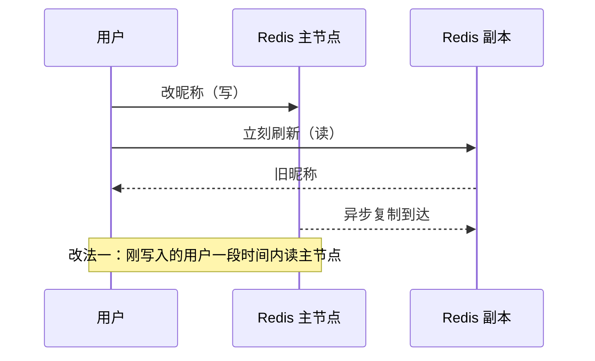

## Q
**Redis · 写完立刻读为什么读到旧值**｜考点 · 必会

用户改完昵称，立刻刷新界面却还是旧昵称。服务把读流量发给了 Redis 副本。原因是什么？怎么改？

## A
- **原因：** 复制是异步的，副本落后主节点一个复制延迟，刚写的值可能还没到。
- **改法一，写后读主：** 对刚写入的用户的昵称，一段时间内读主节点（可在会话里记一个"最近写入时间"），其他读仍走副本。
- **改法二，同步等待：** 写后用 `WAIT 1 timeout` 等一个副本确认，再返回，延迟变高，而且 `WAIT` 并不能让系统强一致（故障转移时仍可能丢）。
- **改法三，客户端把新值直接带回去：** 写入后用响应内容更新本地视图，不依赖立即重读。
- **面试要点：** 说出读副本的代价是读到旧数据，并说明哪些读容忍它、哪些必须读主。

