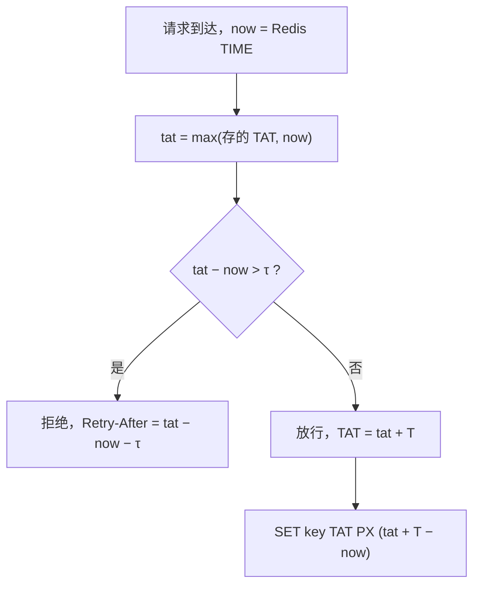

## Q
**Redis · GCRA：每个键只存一个时间戳的限流**｜拓展 · 追问

令牌桶每个键要存"令牌数"和"上次补充时间"两个值。GCRA（通用信元速率算法，Generic Cell Rate Algorithm）怎样只用一个数做到同样的限流？在 Redis 里怎么写，返回什么？

## A
**一句话。** 不记"桶里还剩几个令牌"，只记"理论到达时间" TAT（Theoretical Arrival Time）：按限定速率，下一个请求最早应该什么时候来。每放行一个，TAT 往后推一个间隔；TAT 比现在超前得太多，说明近期用得太猛，就拒绝。

**三个量。**
- **间隔 T：** `T = 周期 ÷ 次数`。每秒 10 次，T = 100 ms。
- **突发容差 τ：** `τ = (突发数 − 1) × T`。允许连发 5 个，τ = 400 ms。
- **TAT：** 每个键在 Redis 里只存它，`SET key <TAT> PX <ttl>`。

**步骤。**
1. **取时间：** 脚本里用 Redis 的 `TIME`，所有网关共用一个时钟。
2. **补齐空闲：** `tat = max(TAT, now)`。键不存在或很久没来，TAT 落后于现在，取 now，相当于桶是满的。
3. **判断：** `tat − now` 是"已经透支的时间"。超过 τ 就拒绝，不写任何东西。
4. **放行：** 新 TAT = `tat + T`，写回。
5. **过期：** TTL 设成 `新 TAT − now`。到期时 TAT 一定已落后于当时的 now，删掉与不删等价，内存只跟活跃键走。
6. **返回值：** 被拒时等待时间 `tat − now − τ`；放行时剩余额度 `⌊(τ − (新 TAT − now)) ÷ T⌋ + 1`，直接填 `Retry-After` 和 `X-RateLimit-Remaining`。

**例子。** 每秒 10 次、突发 5（T = 100，τ = 400）。在 now = 0 连发：TAT 依次变成 100、200、300、400、500，第 6 个到来时 `tat − now = 500 > 400`，被拒，要等 100 ms。到 now = 100，`500 − 100 = 400`，不超过 τ，放行。

**为什么这样，不那样。**
- **对比令牌桶：** 两者放行结果相同，GCRA 少存一个字段，脚本里没有"按经过时间补令牌"的乘法和封顶。
- **对比滑动窗口计数：** 窗口算法按窗口边界估算，GCRA 精确到每个请求，并且天然算出精确的重试时间。

**易错。**
- **用网关本机时钟：** 各网关时钟不一致，TAT 前后跳；必须在脚本里取 `TIME`。
- **拒绝时也推进 TAT：** 被拒的请求会继续透支，客户端越重试越被拒。
- **相关产品：** Redis 模块 redis-cell 的 `CL.THROTTLE` 就是 GCRA，一次返回是否受限、上限、剩余、重试等待和重置时间。
