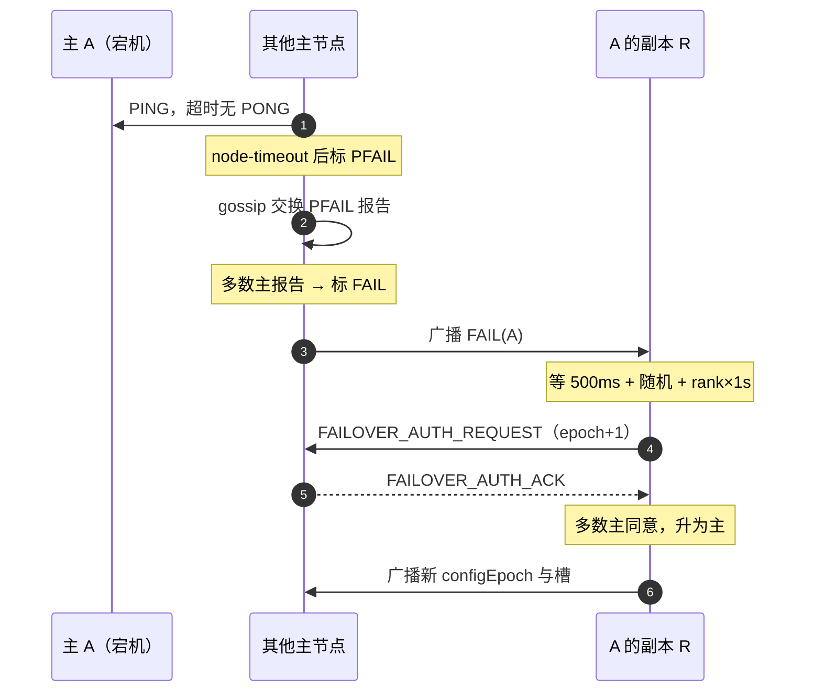

## Q
**Redis · Cluster 主节点宕机：谁发现、谁投票、谁接管**｜拓展 · 必会

Redis Cluster 里没有哨兵，也没有中心协调者。一个主节点进程挂了，是谁判定它死了？它的副本怎样成为新主？整个过程大约要多久？

## A
**一句话。** 每个节点自己 ping 别人，超过 `cluster-node-timeout` 没回应就在本地标记 PFAIL（可能故障）；多数主节点在两倍超时内都报告它 PFAIL，就升级为 FAIL 并广播；它的副本按复制进度排名错开启动，向所有主节点拉票，拿到多数主节点的票就升为新主，接管原来的槽。

**步骤。**
1. **心跳：** 节点经集群总线（数据端口 + 10000）互发 PING/PONG，消息里顺带 gossip 别的节点的状态。
2. **PFAIL：** 某节点对 A 发出的 ping 超过 `cluster-node-timeout`（默认 15000 ms）没有回复，在本地给 A 打 PFAIL。这只是一个节点的看法，不触发任何动作。
3. **FAIL：** 节点从 gossip 里收集别人对 A 的故障报告。在 `node-timeout × 2` 时间内多数主节点都报告了 PFAIL 或 FAIL，它就把 A 标成 FAIL，并向全体广播 FAIL 消息，收到的节点一律标 FAIL。
4. **副本排名：** A 的副本互相比较复制偏移量，数据最新的 rank 0，其次 rank 1。每个副本等待 `500 ms + 0~500 ms 随机 + rank × 1000 ms` 再参选，数据最新的通常先拉票。
5. **拉票：** 副本把 `currentEpoch` 加一，向所有主节点广播 `FAILOVER_AUTH_REQUEST`，最多等 `node-timeout × 2`（至少 2 秒）。
6. **投票规则：** 主节点确认 A 处于 FAIL、本纪元还没投过票，就回 `FAILOVER_AUTH_ACK`；投过之后 `node-timeout × 2` 内不再给 A 的其他副本投票。
7. **接管：** 拿到多数主节点的票，副本升为主，取得新的 `configEpoch`，广播"这些槽归我"。其他节点按更大的 configEpoch 更新槽表；客户端下次打到旧地址会收到 `MOVED`。
8. **失败重来：** 两倍超时内凑不够多数，本轮作废，`node-timeout × 4`（至少 4 秒）后再试。

**数字。**
- **总时长：** 大约 `node-timeout` 加几秒；官方规范说选举本身通常 1–2 秒。默认 15 秒的超时意味着这个分片的写入要停约 15–20 秒。
- **副本太旧不参选：** 与主断开超过 `node-timeout × cluster-replica-validity-factor + repl-ping-replica-period` 的副本不会发起选举，设为 0 则总会尝试。

**为什么这样，不那样。**
- **不用每个节点各自判死：** 一个节点看不见 A 可能只是它自己的网络问题；要求多数主节点一致，才把"局部看法"变成"集群结论"。
- **投票者是主节点，不是副本：** 多数派以主节点计，所以集群至少要 3 个主节点，少于 3 个时挂一个就凑不够多数。
