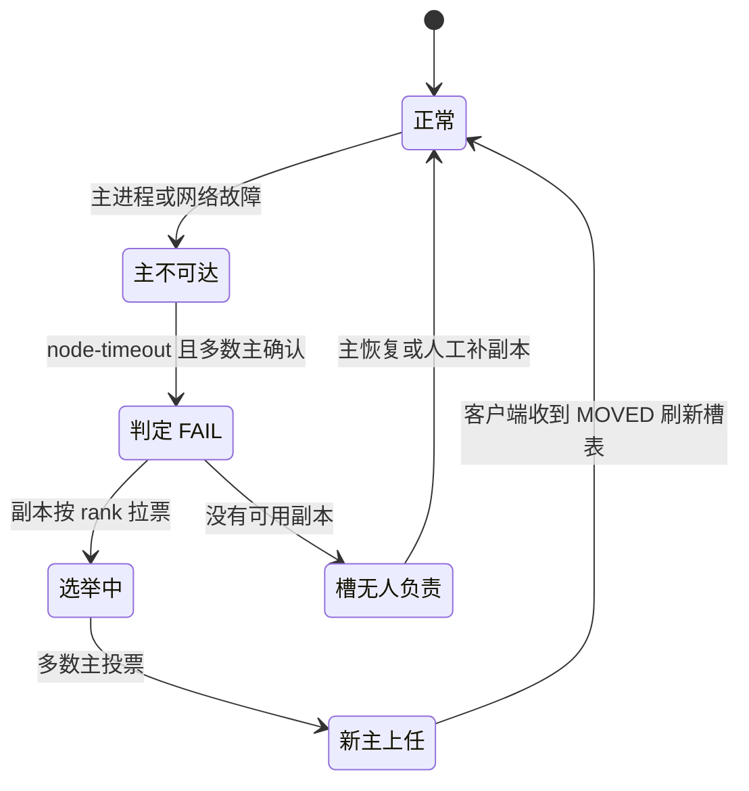

## Q
**Redis · Cluster 切换期间客户端看到什么：超时、CLUSTERDOWN、MOVED、丢写**｜拓展 · 追问

一个分片的主节点挂了，到新主上任前后，打到这个分片和其他分片的请求分别会怎样？`cluster-require-full-coverage` 设成 yes 和 no 有什么区别？哪些已确认的写会丢？

## A
**一句话。** 挂掉的分片在 node-timeout 加选举的十几秒里写不进去；默认的 `cluster-require-full-coverage yes` 一旦有槽无人负责，整个集群都拒绝服务，设成 no 才让其他分片照常工作；新主上任后客户端靠 `MOVED` 刷新槽表；已确认但没来得及复制的写会丢。

**客户端在各阶段看到的。**
- **主不可达到选出新主之前：** 发到这个分片的命令连接超时或报错，客户端库按配置重试。别的分片不受影响。
- **槽无人负责：** 这个分片没有可升的副本时，它的槽处于未覆盖状态。`cluster-require-full-coverage yes`（默认）下所有节点都回 `CLUSTERDOWN`，整个集群停摆，直到槽重新有主；`no` 时只有这部分槽的键失败，其余照常。
- **只想读：** `cluster-allow-reads-when-down yes` 让节点在集群处于 down 状态时，只要自认为拥有槽，仍然服务读。适合缓存，不适合要求一致的数据。
- **新主上任后：** 客户端缓存的槽表还指向旧地址；连到其他节点会收到 `MOVED <slot> <新主地址>`，客户端刷新整张槽表（`CLUSTER SHARDS`）后再发。`ASK` 只出现在槽迁移途中，与故障切换无关。

**哪些写会丢。**
- **异步复制的窗口：** 主回复了 OK，但写还没传到副本就宕机；副本被选为新主，这些写就没了。
- **少数派一侧：** 网络分区时，被隔离在少数一侧的旧主仍会接受写，最长 `node-timeout`；超过后它发现联系不上多数主，自己停止接受写。多数一侧选出新主后，旧主这段时间的写全部作废。
- **缩小窗口：** 关键写后调用 `WAIT 1 <ms>`，等至少一个副本确认；它降低丢失概率，但不能把 Redis 变成强一致存储。

**面试里这样说。** 「一个分片挂了，那个分片写停十几秒；把 full-coverage 关掉，其他分片不受牵连。切换会丢最后几毫秒的已确认写，所以 Redis 里只放丢了能重建的东西，比如限流计数、缓存、在线状态。」

**易错。**
- **以为一个分片挂了只影响它自己：** 默认配置下整个集群都会拒绝服务。
- **把 MOVED 当错误上报：** 它是正常的路由更新，客户端库应自动处理。
