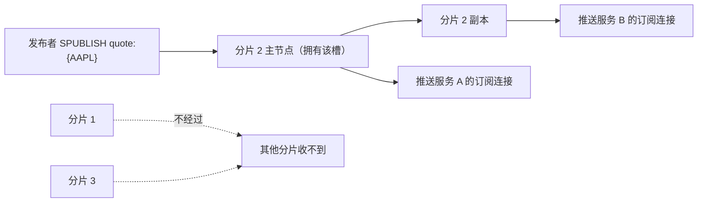

## Q
**Redis · 分片发布订阅怎样路由：频道、槽与连接**｜拓展 · 必会

`SPUBLISH` / `SSUBSCRIBE` 把一条消息送到哪些节点？订阅者要连哪个节点、一次能订哪些频道？推送服务要订阅一万个频道，连接怎么管？

## A
**一句话。** 分片频道（shard channel）像键一样按 `CRC16(频道名) mod 16384` 落到一个槽；`SPUBLISH` 必须发给拥有这个槽的主节点，消息只在这个分片内（主和它的副本）传播；订阅者连这个分片的主或任一副本，就能收到。

**步骤。**
1. **算槽：** 频道名按键的规则算槽，花括号里的哈希标签同样生效。`quote:{AAPL}` 只对 `AAPL` 算槽，可以和快照键 `price:{AAPL}` 放在同一个分片。
2. **发布：** 客户端库按本地槽表把 `SPUBLISH` 发给该槽的主；发错了节点会收到 `MOVED`，刷新槽表后重发。
3. **分片内转发：** 主节点把消息投给自己的订阅者，并转发给本分片的副本，副本再投给连在它上面的订阅者。别的分片完全不参与。
4. **订阅：** `SSUBSCRIBE` 一次可以写多个频道，但它们必须属于同一个槽，否则报错；不同槽要分开调用，通常每个分片一条订阅连接。
5. **收消息：** 推送内容是 `smessage <频道> <内容>`，与经典 Pub/Sub 的 `message` 区分开。

**和经典 Pub/Sub 的区别。**
- **经典 `PUBLISH`：** 集群中可以发给任意节点，节点把每条消息广播给所有其他节点。节点越多，每条消息的总线流量越大，加节点不加吞吐。
- **分片：** 每条消息只在一个分片内传播，发布容量随分片数线性增长。代价是客户端要知道槽表，并且一个频道的全部流量压在一个分片上。

**连接怎么管。**
- **按分片分组：** 推送服务把要订阅的一万个频道按槽所在的分片分组，每个分片一条连接，在这条连接上分批 `SSUBSCRIBE`（同槽的才能一批）。
- **读写分离：** 订阅可以连副本，把订阅连接的压力从主节点挪开；发布只能发给主。
- **热点频道：** 一个频道只在一个分片，一支热门股票的流量无法再拆；需要时在应用层拆成 `quote:{AAPL}:0..7` 多个频道。

**语义没变。** 仍是至多一次：不存消息，订阅者断开期间的消息直接丢，需要用序号加快照补齐。
