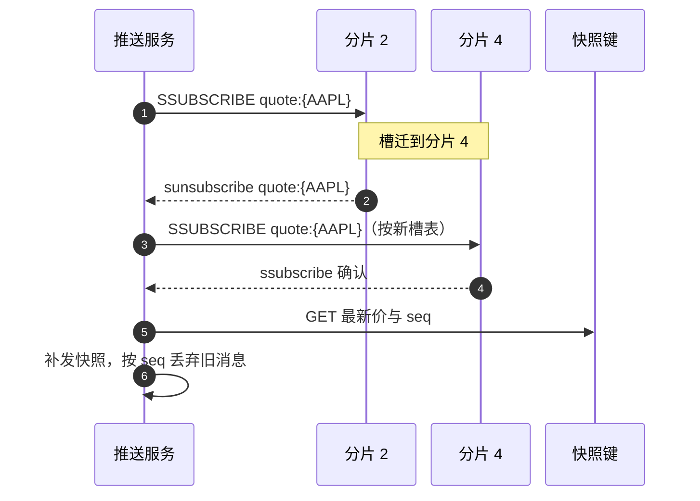

## Q
**Redis · 分片发布订阅遇到槽迁移和故障切换**｜拓展 · 追问

推送服务在分片 2 上 `SSUBSCRIBE quote:{AAPL}`。这时运维把这个槽迁到分片 4，或者分片 2 的主节点挂了。订阅者会收到什么？中间的消息去哪了？客户端该怎么做？

## A
**一句话。** 节点失去一个槽时，会给订阅了该槽频道的每个客户端推一条 `sunsubscribe`，订阅就此结束；主节点宕机则是连接直接断开。两种情况客户端都要按新槽表重新 `SSUBSCRIBE`，中间的消息已经丢了，只能靠重读快照和序号补齐。

**步骤。**
1. **识别信号：** 收到不是自己发起的 `sunsubscribe`，或订阅连接断开，都当成"这个频道的归属可能变了"。不要等 `MOVED`：订阅连接上不一定会出现它。
2. **刷新槽表：** 向任一节点要最新拓扑（客户端库通常自动做），算出频道现在归哪个分片。
3. **重新订阅：** 在新分片上 `SSUBSCRIBE`，等到 `ssubscribe` 确认。
4. **先订阅再读快照：** 确认之后才去读最新状态（带序号），推给本机所有相关连接。顺序反过来，会漏掉"读快照之后、订阅生效之前"的那次更新。
5. **按序号去重：** 订阅生效后到达的消息若序号不大于快照的序号，直接丢弃。

**为什么会丢。** 分片 Pub/Sub 和经典 Pub/Sub 一样不存消息。从旧节点停止投递到新订阅生效之间发布的消息，没有任何地方保存。

**相关配置。**
- **`cluster-allow-pubsubshard-when-down`：** 默认 yes。集群整体处于 down 状态时，节点只要自认为拥有槽，仍继续服务分片 Pub/Sub，所以部分分片故障不必让所有推送都停。
- **定期校验：** 有些客户端库还会周期性比对"我订阅在哪个节点"和"槽表说该在哪"，修掉悄悄漂移的订阅。

**面试里这样说。** 「分片 Pub/Sub 在槽迁移和切换时会断订阅，消息会丢。所以推送服务收到 sunsubscribe 或断线就按新槽表重订，订阅确认后再读一次带序号的快照，客户端按序号去重。」

**易错。**
- **只处理断线，不处理 `sunsubscribe`：** 槽迁移时连接没断，订阅却已经没了，推送悄悄停止。
- **以为切换后自动续上：** Redis 不会替客户端迁移订阅。
