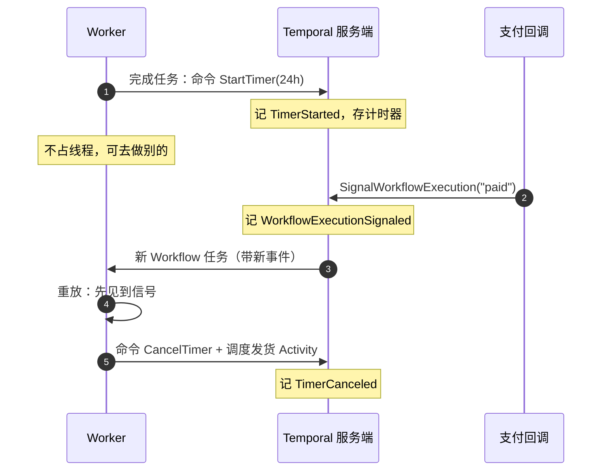

## Q
**Temporal · "等付款信号，或 24 小时后超时"：计时器和信号在服务端怎么走**｜拓展 · 必会

拍卖结束后，Workflow 要等赢家付款：收到"已付款"信号就发货，24 小时没付就顺延给次高出价者。这个"信号或计时器，先到者胜"在 Temporal 服务端是怎么实现的？Worker 在这 24 小时里要一直开着吗？两者几乎同时到达，谁赢？

## A
**一句话。** Workflow 代码执行到等待点时，向服务端提交"开一个 24 小时计时器"的命令，然后这次执行结束、Worker 释放；计时器存在服务端的历史服务（History Service）里。信号到达或计时器到期，服务端都只做一件事：往这个 Workflow 的事件历史追加一条事件，并安排一个新的 Workflow 任务。Worker 重放历史，先看到哪条事件，哪条就赢。

**步骤。**
1. **代码：** TypeScript 里信号处理函数把 `paid` 置为 true，主流程 `const ok = await condition(() => paid, '24 hours')`，超时返回 false；Go 里用 `workflow.NewSelector` 同时等信号通道和 `workflow.NewTimer`。
2. **开计时器：** Worker 把这次执行的结果作为命令交回：`StartTimer`。服务端记入 `TimerStarted` 事件，并在持久化存储里登记一个到期任务。Worker 上这个 Workflow 不再占线程。
3. **信号先到：** 支付回调调用 `SignalWorkflowExecution`。服务端把它追加为 `WorkflowExecutionSignaled` 事件，安排一个 Workflow 任务。
4. **重放决定：** Worker 拿到任务，按历史重放：信号事件在 `TimerFired` 之前，`race` 就由信号胜出。代码接着走发货分支，并取消计时器，服务端记 `TimerCanceled`。
5. **计时器先到：** 24 小时到，服务端的计时器处理器记 `TimerFired`、安排任务；重放时计时器胜出，走"顺延给次高者"分支。之后再来的付款信号仍会写进历史，代码要决定怎样处理它（比如退款）。
6. **几乎同时：** 两条事件在历史里总有先后，每次重放都看到同样的顺序，所以结果确定，不会一次走发货、一次走顺延。

**故障与处理。**
- **Worker 全部宕机：** 计时器照样在服务端到期，`TimerFired` 照样写进历史；Worker 回来后处理，只是晚一点。
- **服务端实例宕机：** 其他实例从存储恢复未触发的计时器。宕机只会推迟触发，不会丢掉计时器。
- **到期精度：** 计时器的时长应理解为"至少这么久"，调度会让它稍晚一点点触发。

**为什么这样，不那样。**
- **对比自建：** 不用 Temporal，就要一张"截止时间表"加扫描器，再用条件更新处理"付款和超时同时到"的竞争；Temporal 用"事件进历史的先后"代替了这把锁。
- **对比 `sleep` 在进程里：** 进程重启就忘了；Temporal 的等待只占存储，一个 Worker 可以同时挂着上百万个计时器。
