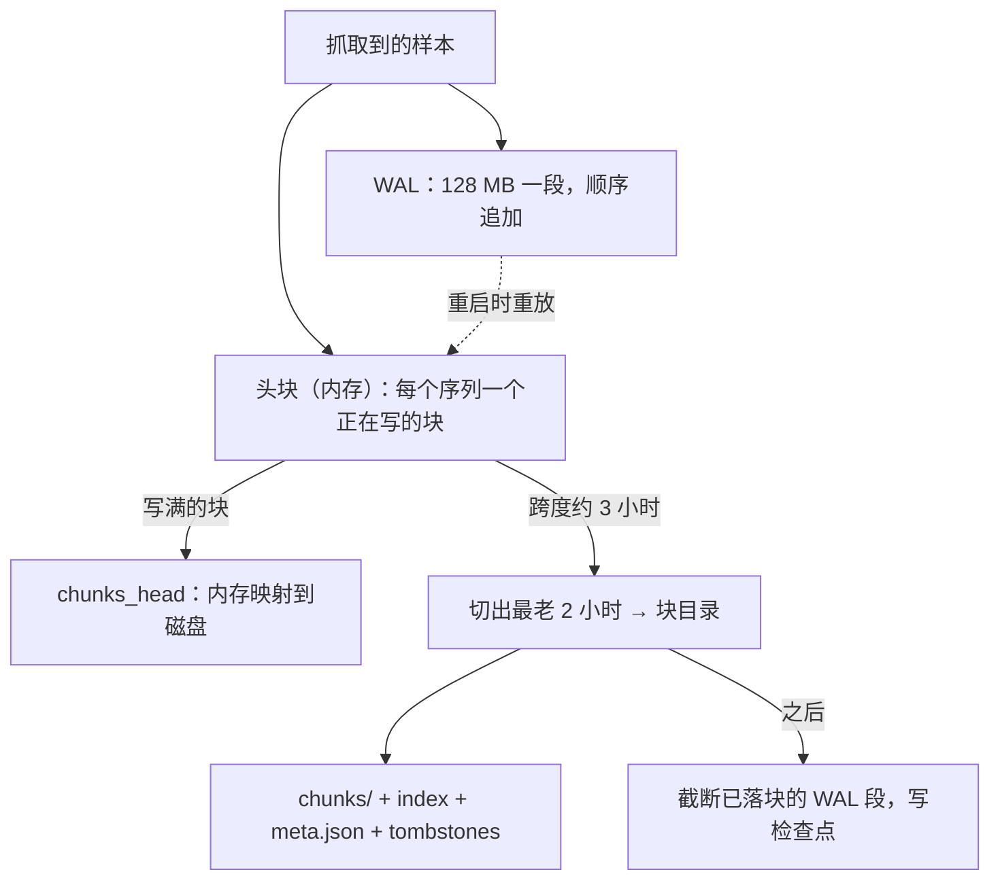

## Q
**时序数据库 · Prometheus 的写路径：头块、WAL 与两小时块**｜拓展 · 必会

一个样本被 Prometheus 抓到之后，存在哪里？进程崩溃时内存里的数据怎么恢复？什么时候才变成磁盘上的不可变文件？

## A
**一句话。** 新样本先追加进内存里的头块（head block），同时顺序写入预写日志（WAL）；头块里的数据跨度达到约 3 小时时，最老的 2 小时被切出来写成一个不可变的块目录，对应的 WAL 段随后截断。崩溃后重放 WAL，把头块重建出来。

**步骤。**
1. **追加到头块：** 每个序列（指标名加一组标签）在内存里有一个正在写的压缩块，时间戳用增量编码、数值用 XOR 压缩。一个块写满（约 120 个样本）就封口。
2. **写 WAL：** 同一批样本和新出现的序列定义按记录顺序写进 `wal/` 目录，128 MB 一段。WAL 只为崩溃恢复，不用于查询。
3. **封口块落盘：** 封口的块写进 `chunks_head/` 并做内存映射，头块只在内存里留引用，内存占用下降，重启时也不必从 WAL 重建这些块。
4. **切块：** 头块覆盖的时间跨度达到块范围的 1.5 倍（默认 2 小时 × 1.5 = 3 小时），把最老的 2 小时写成一个块目录：`chunks/`（数据段文件）、`index`（标签到序列、序列到块的倒排索引）、`meta.json`（时间范围、来源）、`tombstones`（删除标记）。块一旦写成就不再修改。
5. **截断 WAL：** 已经落进块的那段 WAL 被删除，留下的部分先写一个检查点（checkpoint），记录仍然活着的序列，避免重启时重放早已无用的记录。
6. **查询：** 一个时间范围的查询同时读头块和与之重叠的各个块，结果合并。

**故障与处理。**
- **进程崩溃：** 重启时加载内存映射的块，再重放检查点和其后的 WAL 段，头块恢复到崩溃前；最后几毫秒没写进 WAL 的样本会丢，下一次抓取补上新值。
- **重放很慢：** 序列越多、WAL 越长，重启越慢；高基数是重启时间的头号原因。
- **磁盘满：** WAL 写失败，摄入停止；所以 `retention.size` 建议只用磁盘的 80–85%。

**数字。**
- **块大小：** 2 小时；WAL 段 128 MB，至少保留 3 个段，高流量时会更多，以覆盖至少 2 小时的原始数据。
- **默认保留：** 不设任何保留参数时为 15 天。

**为什么这样。** 顺序追加的 WAL 加内存头块，就是 LSM 的"先写日志和内存表、再刷成不可变文件"；按时间切块让删旧数据变成删整个目录。
