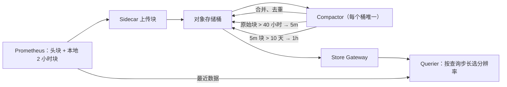

## Q
**时序数据库 · Thanos：块进对象存储，压实器做降采样**｜拓展 · 追问

Prometheus 本地只留 15 天，要保留一年并能查。Thanos 怎样把块搬到对象存储？降采样由谁做、什么时候做、存了什么？降采样能省磁盘吗？

## A
**一句话。** 每台 Prometheus 旁边的 Sidecar 把刚写成的 2 小时块原样上传到对象存储；一个全局唯一的压实器（Compactor）在桶里做合并，再为超过 40 小时的原始块生成 5 分钟分辨率、为超过 10 天的块生成 1 小时分辨率；存储网关（Store Gateway）按时间范围和分辨率从桶里读。降采样不省空间，它省的是长范围查询要读的样本数。

**步骤。**
1. **上传：** Prometheus 写出 2 小时块后，Sidecar 把整个块目录传到桶里。为此 Prometheus 本地压实必须关掉，否则本地合并后的大块会和已上传的小块重复。
2. **桶内压实：** Compactor 把同一来源（同一组外部标签，如 `cluster`、`replica`）的块合并成长块，做法与本地压实相同。
3. **降采样：** 原始块超过 40 小时，生成一份 5 分钟分辨率的块；5 分钟块超过 10 天，再生成 1 小时分辨率的块。每个时间格里每个序列存 count、sum、min、max 和计数器（counter）聚合，所以 `avg`、`max`、`rate` 在低分辨率上仍能算对。
4. **按分辨率保留：** `--retention.resolution-raw`、`-5m`、`-1h` 分别设，例如原始 30 天、5 分钟 180 天、1 小时 1 年。不设或设 0 表示永久保留。
5. **查询：** Querier 同时问 Sidecar（最近数据）和 Store Gateway（历史），按查询步长挑合适的分辨率：看一年用 1 小时，看一天用原始。

**数字。**
- **空间：** 每个原始块会多出两个降采样块，三种分辨率都保留时总量最多约为原来的 3 倍。省空间靠的是给原始数据设更短的保留期。
- **唯一性：** 一个桶里同一组块只能有一个 Compactor 在跑，两个同时跑会互相覆盖、造成重叠块。

**故障与处理。**
- **Compactor 停了：** 块照样上传、照样能查，只是不合并、不降采样，长范围查询变慢；保留期删除在压实之后执行，所以旧数据也不会被删，桶会一直涨。要监控它的最后成功时间。
- **两台 Prometheus 做高可用：** 它们只差一个 `replica` 外部标签，查询时 Querier 按这个标签去重；也可以在 Compactor 上做离线去重。

**为什么这样，不那样。** 降采样在桶里离线做一次，比每次查询现算便宜；放在 Prometheus 本地做则要它承担与抓取无关的重活。
