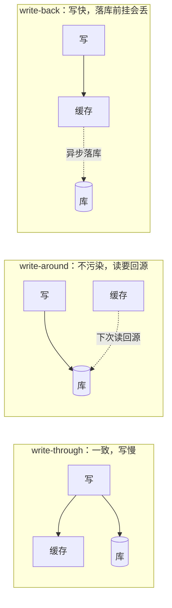

## Q
**关键技术 · 分布式缓存：用途与四件要说清的事**｜摘要 · 必会

缓存适合放什么？面试里被问到缓存，必须说清哪几件事？

## A
- **适合放：** 计算或读取代价高的数据。预聚合指标（后台任务每小时算好，请求直接读）；用户会话（减轻数据库压力）；昂贵查询的结果（如"关注者的帖子列表"，在 Postgres 上联多表可能极慢，算一次存起来）。
- **淘汰策略（缓存满了丢谁）：** LRU 丢最久没访问的，FIFO 丢最早进来的，LFU 丢访问次数最少的。
- **失效策略：** 底层数据变了怎么让缓存跟上，例如活动场地改了，就要让缓存里那个活动失效。
- **写策略：** write-through 同时写缓存和库，一致但写慢；write-around 直接写库绕过缓存，避免污染，但下次读要回源；write-back 先写缓存再异步落库，写快，但缓存在落库前挂掉会丢数据。
- **存什么、用什么结构：** 不要只说"存缓存"。热门活动榜可以用 Redis 有序集合（sorted set）。
- **产品：** Redis 支持字符串、哈希、列表、集合、有序集合、位图、HyperLogLog；Memcached 只有简单键值。

