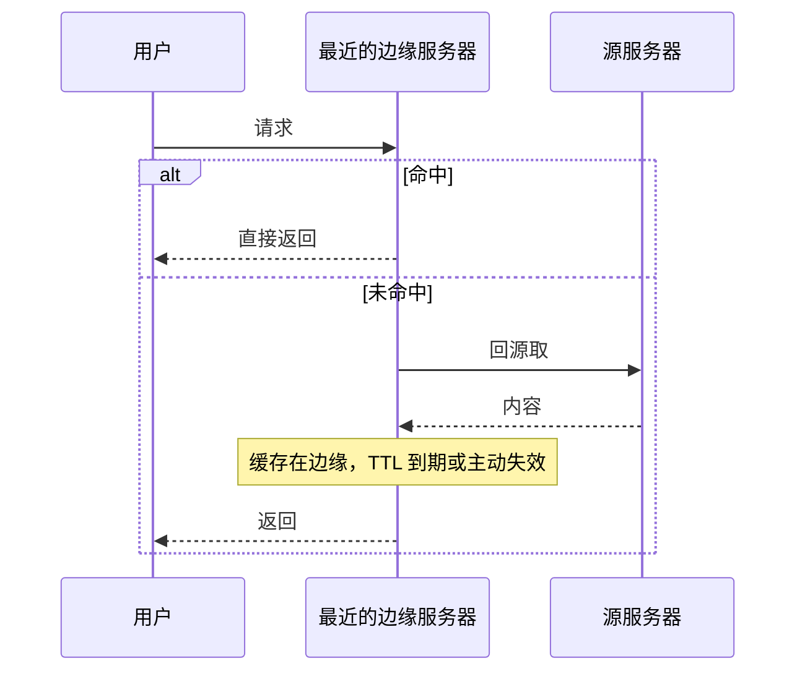

## Q
**关键技术 · CDN**｜摘要 · 必会

CDN 的工作方式是什么？它只能缓存静态资源吗？

## A
- **工作方式：** CDN 是一种按地理位置分布的缓存。用户请求被路由到最近的边缘服务器，命中就直接返回；未命中就回源服务器取，缓存在边缘，再返回。目的是让全球用户加载都快。

- **最常见用法：** 缓存图片、视频等静态媒体，例如社交应用的头像。
- **不只静态：** 变化不频繁但访问频繁的动态内容（每天更新一次的博客文章）也能缓存，甚至缓存 API 响应以减轻源站压力。
- **淘汰与失效：** 和其他缓存一样，用 TTL（存活时间）过期，或在内容变化时主动失效。
- **产品：** Cloudflare、Akamai、Amazon CloudFront，附带 DDoS 防护和 Web 应用防火墙。
