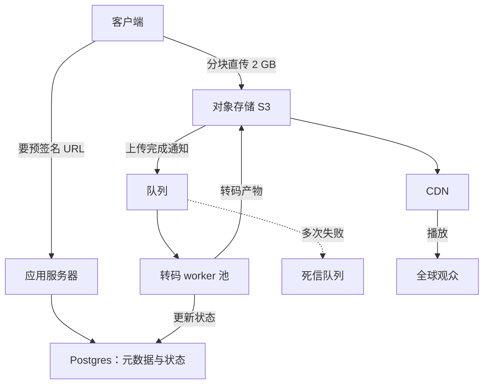

## Q
**关键技术 · 把积木串成一条链路**｜考点 · 必会

设计"用户上传 2 GB 视频，转码后全球观看"。只看技术选型，从上传到播放依次用哪几块积木？每块一句理由，并指出哪一环不该走应用服务器。

## A
1. **核心数据库（Postgres）：** 存视频元数据和处理状态，事务保证状态更新不丢。
2. **对象存储（S3）+ 预签名 URL + 分块上传：** 2 GB 直传对象存储，字节不过应用服务器；分块让失败只重传一块。
3. **上传完成通知 → 队列：** 转码很慢，放进队列由 worker 池消费，削峰且可独立伸缩；失败多次进死信队列。
4. **转码产物回写对象存储，更新数据库状态。**
5. **CDN：** 播放走 CDN 缓存的转码文件，全球低延迟。

- **不该走应用服务器的是文件字节**（上传和下载都直连对象存储 / CDN）。
- **不能加队列的是什么：** 播放时的取流是同步低延迟路径，不放队列。
