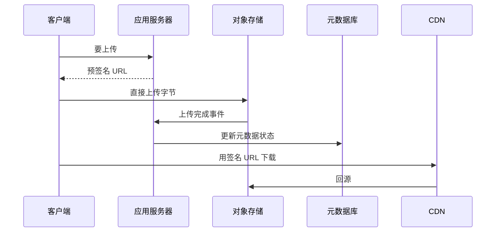

## Q
**常见模式 · 处理大文件**｜摘要 · 必会

视频、图片、文档这类大文件，为什么不让它经过应用服务器？这个模式的难点在哪？

## A
- **做法：** 应用服务器只签发临时、限定范围的凭证（预签名 URL），客户端直接上传到 S3 这类对象存储；下载经 CDN，用签名 URL 控制访问。
- **收益：** 应用服务器不再是带宽瓶颈；顺带得到可恢复上传、进度跟踪、全球分发。
- **难点一，状态同步：** 数据库里的元数据和对象存储里的真实文件可能对不上（上传一半失败、文件在但记录没写）。靠存储服务的事件通知（上传完成事件）去驱动状态更新。
- **难点二，生命周期：** 失败上传留下的残片、过期文件要有清理策略（如生命周期规则）。

