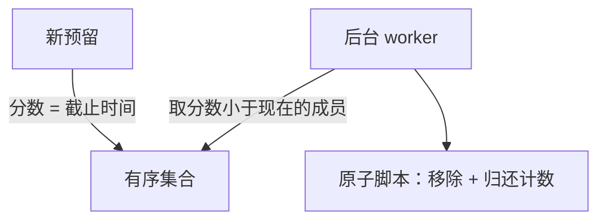

## Q
**Shopify 库存预留 · 旧系统（Redis）里怎么让预留过期**｜摘要 · 必会

为什么给 Redis 计数器设 TTL 不行？按预留各存一个键行不行？还有什么办法？

## A
- **TTL 删的是整个计数器，** 不是某个买家的预留，所以不行。
- **每个预留一个键：** 对分布式锁是对的（锁的是一个具体对象，键存在即全部状态）。但库存是"500 件相同卫衣任选一件"，可用量要统计所有有效预留，而 Redis 键空间是扁平哈希表，找出所有 `hold:*` 键要全量扫描，O(n)，不可能每次预留都做。这就是需要计数器的原因；而有计数器，过期就必须触发一次"归还"写入，Redis 的过期只删键、不执行副作用，还会连记录一起删掉。
- **键空间通知**（keyspace notification）：发了就忘的发布订阅，消费者掉线或读完崩溃就丢。
- **更稳：** 把预留放进有序集合，分数是截止时间；"哪些到期了"就是取分数小于现在的成员。后台 worker 弹出到期项，用原子脚本一次完成"移除并归还计数"，两次运行不会抢到同一个。缺点是受 worker 频率限制，热门商品的几秒死预留也会让买家看到售罄。

