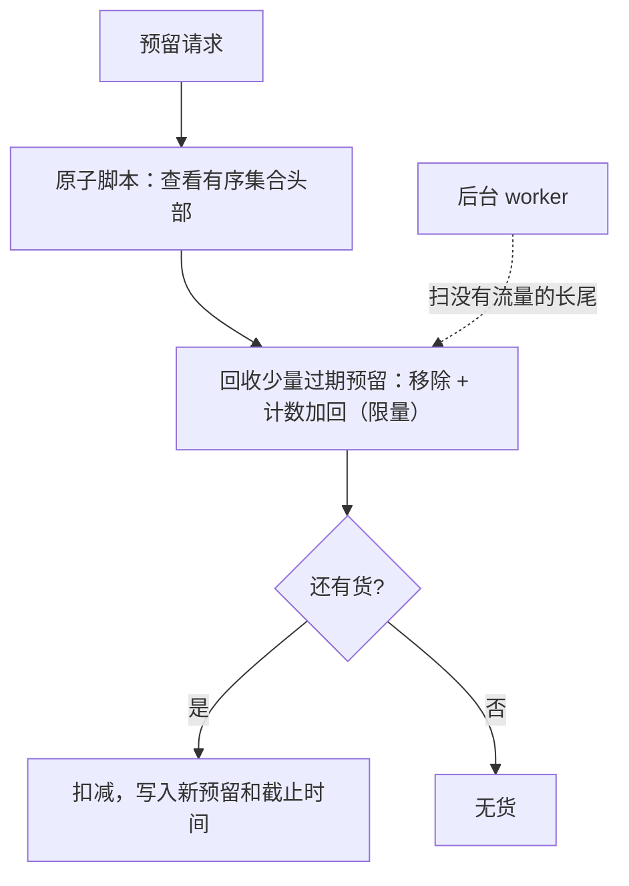

## Q
**Shopify 库存预留 · Redis 里在预留时顺带回收**｜摘要 · 追问

后台 worker 有延迟，能不能让"回收到期预留"和"新预留"在同一个动作里完成？要注意什么？

## A
- **做法：** 每次预留，同一个原子脚本先查看有序集合的头部，回收少量已过期的预留（移除并把计数加回去），确认还有货，再扣减并写入新预留及其截止时间。
- **必须限量：** 脚本执行期间 Redis 会阻塞其他所有命令，一次回收无限多个会让所有买家排在后面。
- **仍需后台清扫：** 流量消失的商品没有下一次预留来清理，长尾要靠后台 worker 扫。

