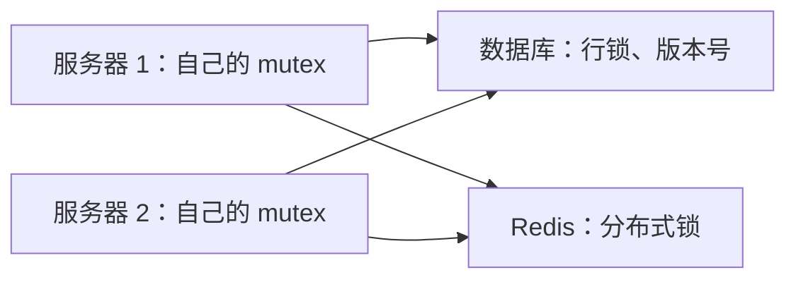

## Q
**处理竞争 · 数据库的锁和语言里的 mutex**｜拓展 · 必会

悲观锁、乐观并发和编程语言里的 mutex 是一回事吗？两台应用服务器抢同一个座位，代码里加 mutex 为什么没用？

## A
**一句话。** 想法相同，都是不让两个人同时改同一份数据；差别在锁放在哪，放在哪就只拦得住看得见它的人。

**锁放在哪。**
- **mutex（互斥锁）：** 在一个进程的内存里；只拦这个进程里的线程；用来保护进程内的东西，比如本地缓存、连接池、内存里的计数器。
- **悲观锁：** 在数据库的那一行上（`SELECT … FOR UPDATE`）；所有服务器的所有连接都到这里排队；事务结束或连接断开时释放。
- **乐观并发：** 没有锁；写的时候比一下版本号，变了就写入 0 行，失败的一方重试；没有人等待。
- **分布式锁：** 在 Redis 或 ZooKeeper 里；要保护的东西不是数据库里的一行时才用，比如调用外部接口。

**两种思路，各有一对。**
- **先拿锁再做，别人等：** 语言里是 mutex，数据库里是悲观锁。
- **先做，提交时比较，输了重试：** 语言里是 CAS（compare-and-swap，如 Java 的 `AtomicInteger.compareAndSet`），数据库里是带版本号的 `UPDATE`。

**常见的错。** 在订票代码外面包一层 `synchronized` 或 `threading.Lock`：一台服务器时有效，扩到两台就各锁各的，同一个座位照样卖两次。被抢的数据在数据库里，锁就要放在数据库里。
