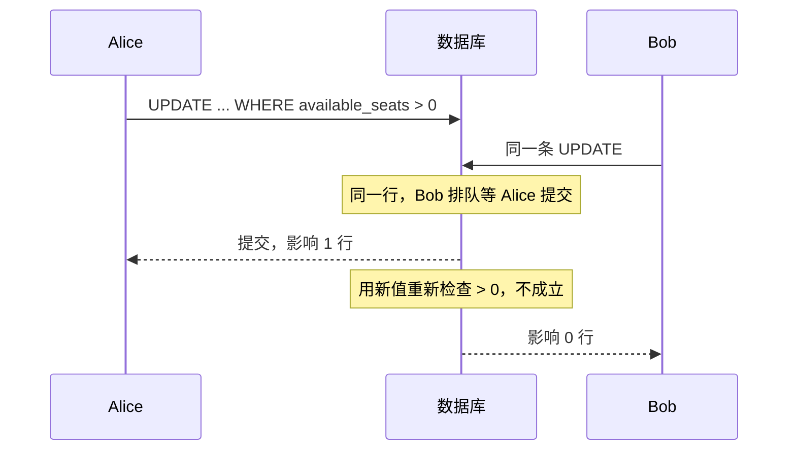

## Q
**处理竞争 · 条件写**｜摘要 · 必会

库存扣减能不能不加任何锁、不加版本号就保证不超卖？这条语句为什么在并发下安全？

## A
- **做法：** 把判断塞进写入语句：`UPDATE concerts SET available_seats = available_seats - 1 WHERE concert_id = ? AND available_seats > 0`。检查和修改成为同一步，没有缝隙。
- **为什么安全：** 数据库不允许两条语句同时改同一行，会让它们排队。后到的 Bob 等 Alice 提交，再用 Alice 留下的新值重新检查 `> 0`，发现不成立，影响 0 行。一个座位只卖一次。

- **隔离级别的影响：** 常见默认级别下是"重新检查后匹配 0 行"；更严格的级别下，输家会直接以序列化错误中止，应用需重试。失败形状不同，结果相同。
- **适用面：** 计数器扣减、状态从 available 改 sold、认领未分配的行，只要判断能写进 WHERE 就够了。
