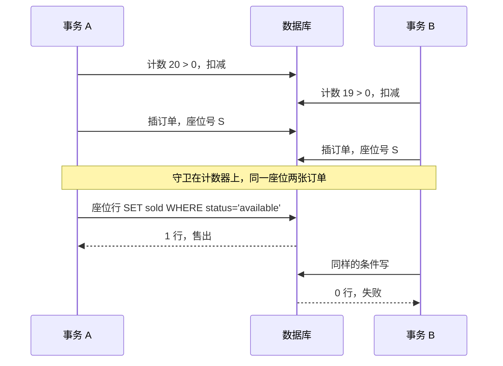

## Q
**处理竞争 · 计数对了座位却重复**｜考点 · 必会

你的方案是 `UPDATE ... SET available_seats = available_seats - 1 WHERE available_seats > 0`，再插一条带座位号的订单。库存剩 20 张时压测发现同一座位被卖给两人，计数却完全准确。为什么，怎么改？

## A
- **原因：** 守卫保护的是计数器，而人们争的是具体座位。两次扣减都成功（20、19 都大于 0），两条订单写入同一个座位号。
- **改法：** 一座一行，对座位行做条件写：`SET status='sold' WHERE seat=? AND status='available'`，第二个匹配 0 行。

- **补充：** 计数变成派生数据，同一事务内更新缓存的计数，或由座位行统计。
- **资深加分：** 一句话概括原则：守卫必须落在被争抢的那个资源上，数据库只能保护它看得见的冲突。
