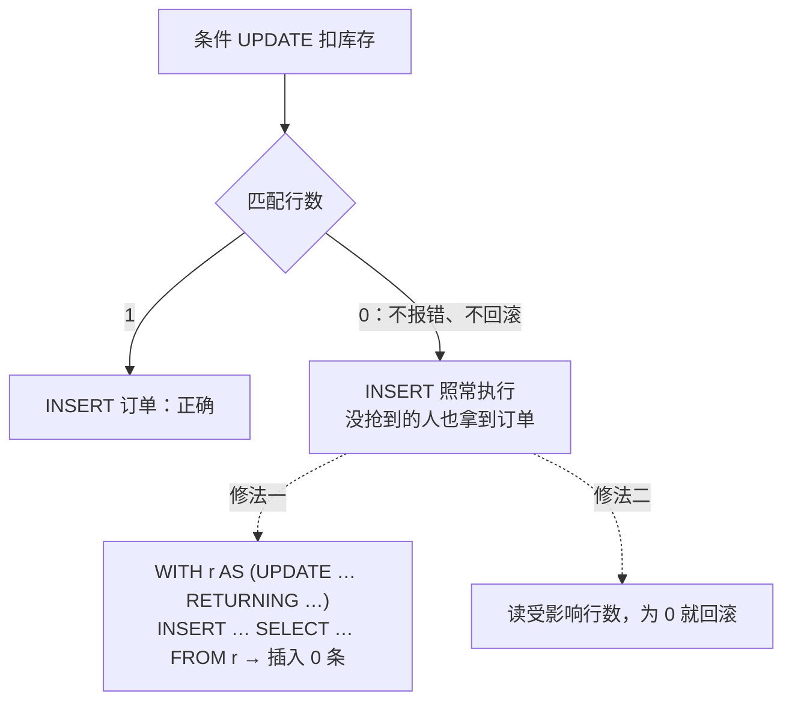

## Q
**处理竞争 · 受影响行数为零**｜考点 · 必会

同事写了事务：先条件 `UPDATE` 扣库存，再无条件 `INSERT` 订单，说"扣不到库存会报错回滚，所以安全"。指出问题并给出两种修法。

## A
- **问题：** `UPDATE` 匹配 0 行不是错误，语句成功，事务不会回滚，后面的 `INSERT` 照常执行，没抢到座位的人得到一张订单。
- **修法一：** 在 SQL 里把插入依赖更新的结果（`WITH r AS (UPDATE ... RETURNING ...) INSERT ... SELECT ... FROM r`），没改到行就插入 0 条。
- **修法二：** 应用里读受影响行数，为 0 就回滚。

- **同样的陷阱出现在：** 乐观并发的版本检查（版本过期同样是 0 行，不报错）。
