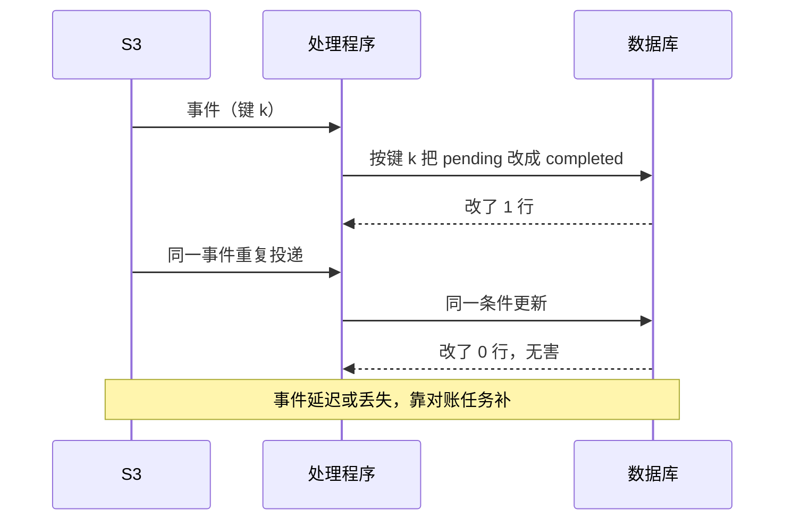

## Q
**大文件 · 存储事件的投递语义**｜拓展 · 加分

用存储事件更新数据库状态，事件会重复或乱序吗？处理程序该怎么写？

## A
- **投递语义：** S3 事件通知保证至少一次投递，可能重复，也不保证顺序。
- **处理程序要幂等：** 以存储键定位行，"把 pending 改成 completed"这样的条件更新重复执行无害；不要用"计数加一"这类非幂等操作。

- **乱序：** 同一个键被覆盖时，先到的可能是后发生的事件；需要时用对象的 ETag 或版本号（开启版本控制）判断新旧。
- **一致性：** 如今 S3 对新对象写入后的读取是强一致的（先写后读一定看得到），所以收到事件后再去读对象不会读到旧状态。
- **仍要对账：** 事件可能延迟甚至丢失，所以对账任务不可省。
