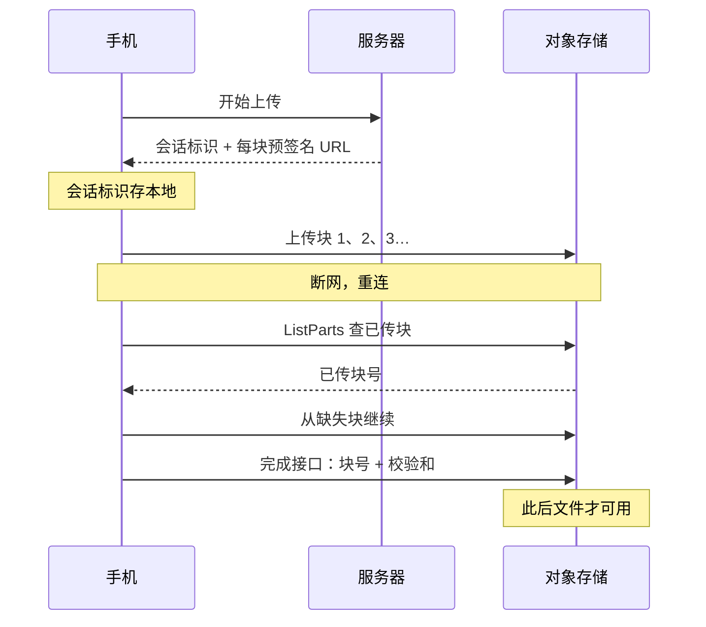

## Q
**大文件 · 不稳定网络上传 5GB**｜考点 · 必会

手机上传 5GB 文件，网络时断时续。设计要点？

## A
- **分块：** 分段上传，每块独立预签名 URL；块大小适中，太小请求多，太大重传代价高。
- **续传：** 客户端保存上传会话标识（可放本地存储），重连后 `ListParts` 查已传块，从缺失处继续。
- **进度：** 每块完成即更新进度条。
- **收尾：** 所有块完成后调用完成接口给出块号与校验和，之前文件不可用。

- **清理：** 生命周期规则 24 到 48 小时清理未完成的分块，避免白付费。
