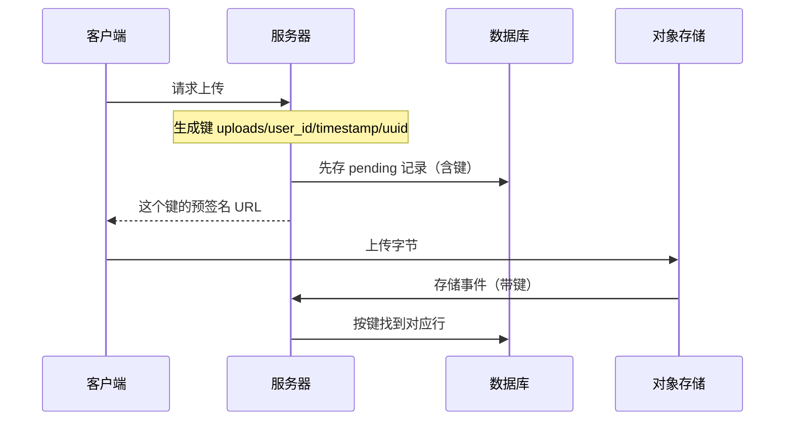

## Q
**大文件 · 让客户端自己起存储键**｜考点 · 必会

接口让客户端传入 `key`，服务器据此生成预签名 URL。有什么问题？

## A
- **问题：** 客户端可以覆盖别人的文件，或写入不该写的路径；键里可能含恶意字符。
- **做法：** 服务器生成键，统一模式如 `uploads/{user_id}/{timestamp}/{uuid}`，既防冲突又带有用信息，并把它先存进 pending 记录。
- **回收：** 存储事件带这个键，据此找到数据库行。

- **要点：** 键由服务器生成、与记录对应，是状态同步的连接点。
