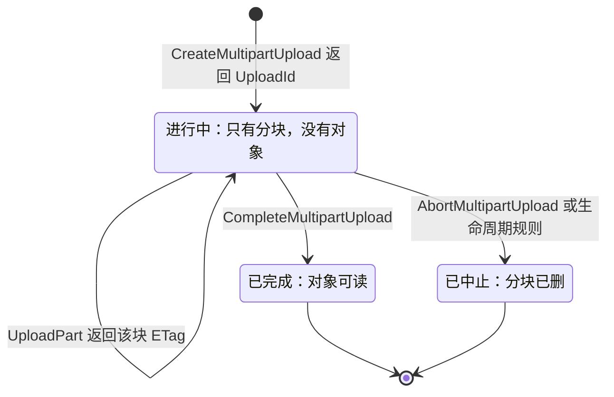

## Q
**大文件 · S3 分段上传协议：三个调用**｜拓展 · 必会

S3 允许把一个大文件切成很多块，并行、乱序地上传。靠哪几个 API？存储端记住了什么，才做得到乱序、并行和单块重传？对象什么时候才能被读到？

## A
- **一句话：** 分段上传（multipart upload）是"开会话、传块、提交清单"三步：会话号 `UploadId` 把所有块绑在一起，块号 `PartNumber` 决定块在对象里的位置，提交时的 `(PartNumber, ETag)` 清单决定对象由哪些块组成。

- **① 开会话：** `CreateMultipartUpload`（`POST /key?uploads`）返回 `UploadId`。对象的元数据、Content-Type、加密方式、校验算法只能在这一步给。
- **② 传块：** `UploadPart`（`PUT /key?partNumber=N&uploadId=X`，请求体是这一块的字节）。S3 把它存成"会话 X 的第 N 块"，响应头返回这块的 `ETag`，调用方必须记下 `(N, ETag)`。
- **乱序、并行从哪来：** 位置由块号决定，与到达顺序无关，所以多条连接可同时传不同的块，先传第 7 块再传第 1 块也行；块号可以不连续（1、5、14 也合法）。
- **单块重传为什么安全：** 同一块号再传一次会覆盖上一次，所以超时后重传同一块是幂等的。
- **③ 提交：** `CompleteMultipartUpload`（`POST /key?uploadId=X`），请求体按块号升序列出 `(PartNumber, ETag)`。S3 只拼接清单里的块，按块号升序连成一个对象。ETag 对不上或块不存在返回 `InvalidPart`，顺序不对返回 `InvalidPartOrder`，非最后一块小于 5 MiB 返回 `EntityTooSmall`。
- **何时可见：** 提交成功之前，这个键读到的仍是旧对象或 404，普通列举也看不到它，只有 `ListMultipartUploads` 能查到这次上传；提交成功后，它和普通 PUT 的对象一样立刻强一致可读，分块不再单独存在。
- **合成对象的 ETag：** 是"各块校验和的校验和"，形如 `"3858…c11f-9"`（`-9` 是块数），不是整个文件的 MD5。
- **数字：** 块 5 MiB 到 5 GiB，最后一块没有下限；块号 1 到 10,000；单个对象最大 48.8 TiB；官方建议 100 MB 以上就用分段上传。100 GB 文件按 100 MB 一块，共 1,002 次调用（开 1 次、传 1,000 次、提交 1 次）。
