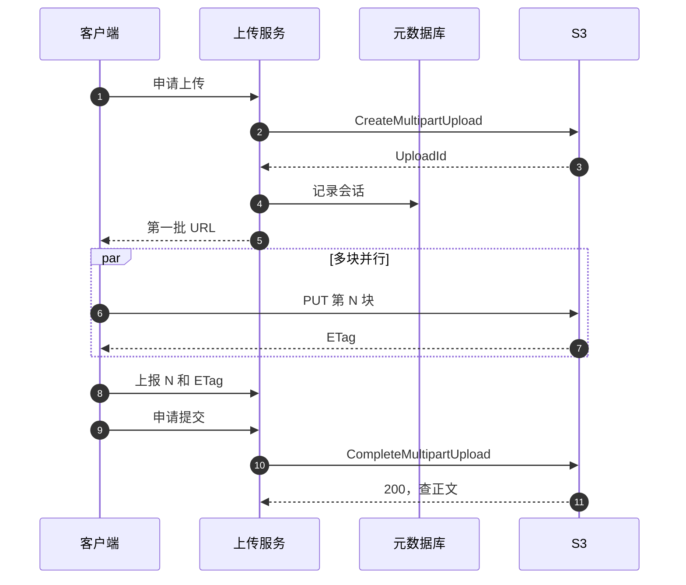

## Q
**大文件 · 预签名分段直传：字节不经应用服务器**｜拓展 · 必会

客户端要用分段上传传一个 20 GB 的视频，但它没有云凭证，字节也不能经过你的服务器。谁调用哪个 API？URL 怎么签？每块的 ETag 怎么回到你手里？

## A
- **一句话：** 服务器用自己的凭证做三件小事：开会话、为每一块签一个 `UploadPart` URL、最后提交；客户端只拿这些 URL 把字节直接 PUT 给 S3，再把每块的 ETag 报回服务器。

- **① 开会话在服务器（图中 1–4）：** 服务器校验用户和配额，自己生成存储键（不让客户端选），调用 `CreateMultipartUpload` 拿到 `UploadId`，和块大小一起写进数据库。匿名用户不能开分段上传，这一步本来就要持凭证的一方做。
- **② 每块一个 URL（图中 5）：** 预签名的是 `UploadPart` 请求本身：方法 PUT、键、查询参数 `uploadId=X&partNumber=N` 都在签名里，所以第 3 块的 URL 只能写这个会话的第 3 块。签名在服务器内存里算，不调用 S3。
- **③ 分批发 URL：** 不必一次签 10,000 个；先发前几十块，客户端边传边领，有效期就能设得短（如 15 分钟）。
- **④ 客户端直传（图中 6–8）：** 浏览器或 App 对每个 URL 发 `PUT`，开几路并行，读响应头 `ETag`，每传完一块就上报 `(N, ETag)`。
- **浏览器要配 CORS：** 跨域时前端默认读不到 ETag 响应头。桶的 CORS 规则要允许 PUT，并在 `ExposeHeaders` 里列出 `ETag`，否则请求明明成功，前端拿到的 ETag 却是空的，最后无法提交。
- **⑤ 提交也在服务器（图中 9–12）：** 客户端只说"传完了"，服务器用自己记录的 `(N, ETag)` 调 `CompleteMultipartUpload`，响应即使是 200 也要检查正文里有没有 `<Error>`；可带 `x-amz-mp-object-size` 让 S3 核对总大小，不符返回 400。
- **为什么不让客户端提交：** 提交决定对象由哪些块组成；放在服务器，总大小、块清单、配额都由你核对，客户端谎报也写不进去。
- **URL 过期：** S3 在请求开始时检查是否过期，传到一半过期不受影响；但断线后拿过期 URL 重传会被拒，要向服务器重新领。用临时凭证（如 IAM 角色）签的 URL，最晚随凭证一起失效，写了更长的有效期也没用；IAM 用户凭证签的 URL 最长 7 天。
