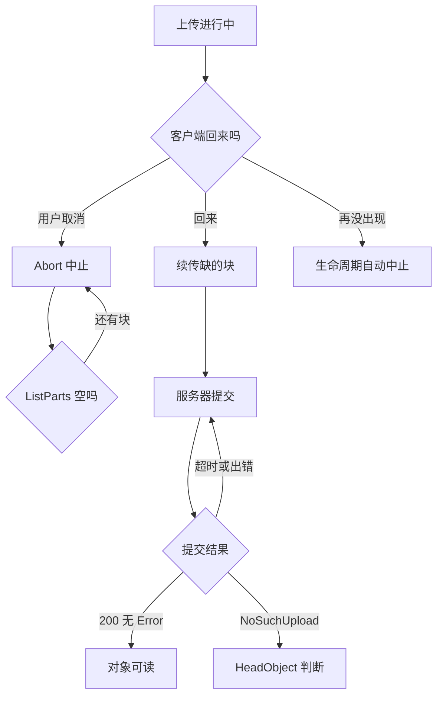

## Q
**大文件 · 分段上传的收尾：提交失败、中止与遗留清理**｜拓展 · 追问

用户传到一半关了 App 再也没回来；或者 `CompleteMultipartUpload` 超时了。已经传上去的块会怎样？会一直收钱吗？谁来清理，提交失败怎么重试？

## A
- **一句话：** 未完成的分段上传没有过期时间，分块一直计费，直到有人提交或中止；用户取消时服务器主动中止，再用生命周期规则 `AbortIncompleteMultipartUpload` 兜底；提交失败就带同一份清单重试。

- **会一直收钱：** 发起后不会自动过期；已传的块按存储、请求和流量计费，直到提交或中止。中止或清理未完成上传没有提前删除费。
- **主动中止：** 用户取消时服务器调用 `AbortMultipartUpload`，已传的块被删，这个 UploadId 再传块返回 `NoSuchUpload`。中止那一刻还在传的块可能照样成功落盘，所以等在途请求结束再中止，或中止后用 `ListParts` 确认为空，不空就再中止一次。
- **兜底清理：** 桶上配生命周期规则 `AbortIncompleteMultipartUpload`，`DaysAfterInitiation` 设得比最长合理上传时间略长（如 7 天）。规则对已有和以后的上传都生效，只删未完成上传的块，不删任何对象。`ListParts` 的响应头 `x-amz-abort-date` 告诉你这次上传何时会被清掉。
- **巡检遗留：** `ListMultipartUploads` 列出桶里所有进行中的上传（每页最多 1,000 个），用来对账和报警。
- **提交的坑一，200 也可能失败：** 拼装可能要几分钟。S3 先回 200，再定期发空白字符保持连接，出错时把 `<Error>` 写进 200 的正文。直接调 REST 必须解析正文；SDK 会识别并按配置重试。
- **提交的坑二，重试的判断：** 超时或 5xx 后用同一 UploadId 和同一份清单重试。返回 `NoSuchUpload` 说明会话已关：可能上一次其实成功了，也可能已被中止；先 `HeadObject` 看对象在不在，再决定标完成还是从头来。
- **同一个键的并发上传：** 未开版本控制时，同一个键上两个分段上传谁最终生效不由你控制。要"只在不存在时创建"，提交时带 `If-None-Match: *`：键已存在返回 412；并发冲突返回 409，要重新开会话、重传各块。存储键由服务器按 UUID 生成，就不会撞键。
