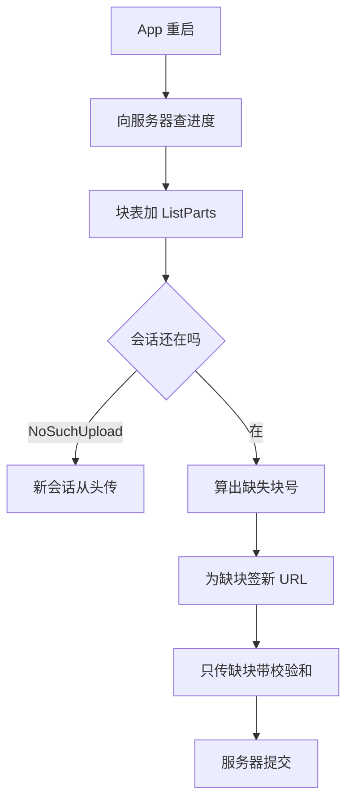

## Q
**大文件 · 崩溃后续传：状态存在哪，怎么接着传**｜拓展 · 必会

上传 20 GB 时 App 崩溃了，重启后要从断点继续。续传需要哪些状态，分别存在哪里？完整流程是什么？怎么保证每一块没传坏？

## A
- **一句话：** 续传只需要四样东西：存储键、`UploadId`、固定的块大小、已完成块的 `(N, ETag)`。以服务器的块表为准，用 `ListParts` 核对 S3 实际有什么，只给缺的块签新 URL，每块带校验和让 S3 当场验收。

- **状态放三处，各管一件事：**
  - 客户端本地（localStorage、IndexedDB 或 App 文件）：上传 id、文件指纹、块大小、已完成块。只够同一设备续传，清缓存就丢。
  - 服务器的块表 `upload_parts(upload_id, part_number, etag, size, checksum)`：客户端每传完一块就上报一行。换设备、换网络都能续，也是提交清单的来源。
  - S3 的 `ListParts`：S3 实际持有哪些块，带 ETag、大小、校验和；只列已经传完的块。
- **为什么不能只靠 ListParts：** AWS 明确要求提交清单用你自己记录的块号和 ETag，`ListParts` 只用来核对。它每页最多 1,000 块，更多要看 `IsTruncated`，把 `NextPartNumberMarker` 作为下一次请求的 `part-number-marker` 翻页。
- **块大小必须固定：** 第 N 块对应字节 `[(N-1)×块大小, N×块大小)`。续传时换了块大小，已传的块就和文件位置对不上，所以块大小要和 UploadId 一起持久化。
- **URL 一律重签：** 旧 URL 可能已过期，续传时只为缺失块签新的。
- **逐块校验：** 每块带 `Content-MD5`，或带 `x-amz-checksum-crc32`、`-crc32c`、`-crc64nvme`、`-sha256` 等头；算法在 `CreateMultipartUpload` 时选定，所有块用同一种。S3 收到后重算，不一致就拒绝这次 `UploadPart`，坏块根本落不了盘，重传同一块号即可。
- **用附加校验和时块号从 1 连续编号：** 块号不连续会在提交时失败。
- **会话被清掉了：** 生命周期规则或用户取消已中止会话时，`ListParts` 返回 `NoSuchUpload`，只能开新会话从头传；`DaysAfterInitiation` 要比用户可能离开的时间长。
