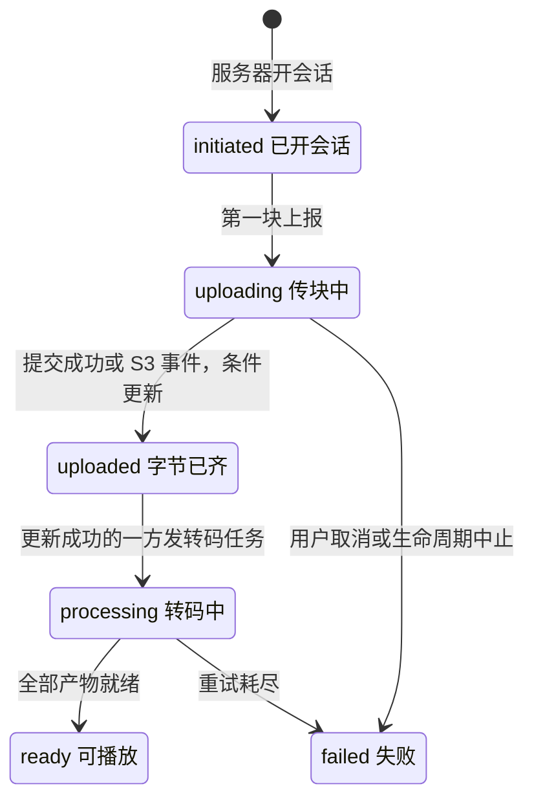

## Q
**大文件 · 上传完成信号：事件驱动的状态机**｜拓展 · 必会

分段上传提交成功后，怎样可靠地把视频从"上传中"推进到"待处理"，并且只触发一次转码？S3 事件会重复、乱序、延迟，处理程序怎么写？

## A
- **一句话：** 两条信号（服务器自己的提交成功、S3 的 `ObjectCreated:CompleteMultipartUpload` 事件）都去做同一个带前置状态的条件更新，谁先到谁生效，后到的更新 0 行就直接确认丢弃；只有更新成功的一方发转码任务。

- **事件每个对象只发一次：** S3 不为单个分块发事件；`s3:ObjectCreated:CompleteMultipartUpload`（或通配 `s3:ObjectCreated:*`）在提交成功时触发，带键、大小、ETag、`sequencer`，可投到 SQS、SNS、Lambda 或 EventBridge。块级进度只能靠客户端上报。
- **投递语义：** 至少一次（at-least-once）；通常几秒到达，偶尔一分钟以上；不保证顺序，少数情况会重复。SQS FIFO 队列不能直接做目标，要经 EventBridge 转。
- **幂等的条件更新：**
  `UPDATE videos SET status='uploaded', size=?, etag=? WHERE storage_key=? AND status IN ('initiated','uploading')`
  影响 1 行才继续；影响 0 行说明已处理过（重复事件，或另一条信号先到），确认消息即可。状态只向前走，所以重复和乱序都无害。
- **同一个键的新旧：** 同一个键被写多次时用 `sequencer` 判断先后：两个值先左补零到等长，再按字典序比较，大的发生得更晚；不同键之间不可比较。把处理过的 sequencer 存在行上，更旧的事件直接丢。
- **收到事件后放心去读：** S3 对 PUT、DELETE 以及 HEAD 等元数据读取都是强读后写一致（strong read-after-write），处理程序 `HeadObject` 核对大小和校验和不会读到旧状态。
- **改状态与发任务要原子：** 条件更新和"写一条待发的转码任务"放进同一个数据库事务（发件箱 outbox），再由投递进程发出；否则状态改了任务却没发，视频永远卡在 uploaded。
- **事件丢了：** 定期扫描长时间停在 uploading 的行，用 `HeadObject` 或 `ListParts` 核实后补推进或清理。
- **为什么不只信客户端：** 客户端可能崩溃、断网或谎报；事件来自存储本身，客户端通知只是让快路径更快。
