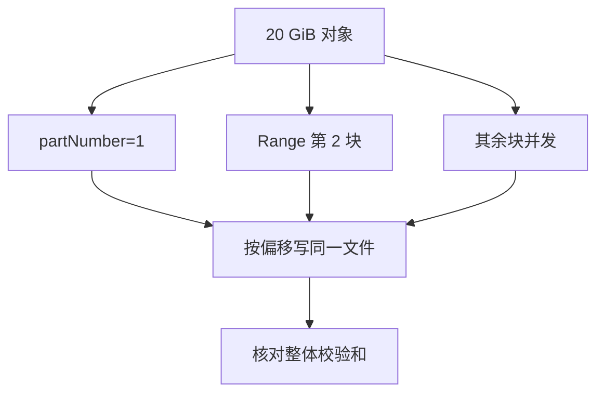

## Q
**大文件 · S3 吞吐上限、并行下载与传输加速**｜拓展 · 追问

S3 每秒能扛多少请求，上限按什么算？怎样让单个 20 GB 文件下载更快？跨洲用户往一个中心桶上传慢，怎么办？

## A
- **一句话：** S3 的速率上限按"分区前缀"算，不按桶算，靠多前缀、多连接横向扩；单个大对象上传靠并行分块，下载靠与块对齐的并行 Range GET；跨洲上传再加 Transfer Acceleration。

- **请求速率：** 每个分区前缀（partitioned prefix）至少每秒 3,500 次 PUT/COPY/POST/DELETE、5,500 次 GET/HEAD；桶里前缀数不限，10 个前缀并行读就是 55,000 次/秒。连接数也不限。
- **扩容是渐进的：** 流量突增时 S3 逐步扩，期间返回 503 Slow Down，扩完自然消失。SDK 自带退避重试；长期热点要把键分散到更多前缀（如键里带哈希前缀）。
- **每个 UploadPart 都算一次写：** 块越小请求越多；100 GB 按 100 MB 一块是 1,002 次调用。海量并发上传先撞的常是写速率，而不是带宽。
- **并行下载：** AWS 建议把大对象拆成多个 Range GET 走多条连接，聚合吞吐比单个整对象请求高，某段失败只重试这一段。对分段上传的对象，按原块大小对齐取：块大小 100 MiB 时第 2 块是 `Range: bytes=104857600-209715199`；也可直接 `GET ?partNumber=N` 取第 N 块。
- **Transfer Acceleration：** 桶级开关。客户端改用 `<桶名>.s3-accelerate.amazonaws.com`，字节先进最近的 CloudFront 边缘节点，再走 AWS 优化的网络路径到桶所在区域。适合全球用户往一个中心桶上传、跨洲定期传 GB 到 TB。要求桶名符合 DNS 规则且不含点、用虚拟主机式请求；开启后最多 20 分钟见效；在数据传输费之外按 GB 另收费，S3 判断不会更快的上传不收加速费。可以和分段上传、预签名 URL 叠加。
- **它不是 CDN：** 加速的是单次传输，不缓存内容；百万人看同一个视频要靠 CloudFront 缓存。
- **延迟量级：** 小对象首字节约 100 到 200 毫秒；要个位数毫秒得加 CloudFront 或缓存层。
- **同区域：** 计算和桶放在同一区域，延迟低，也省跨区流量费。
