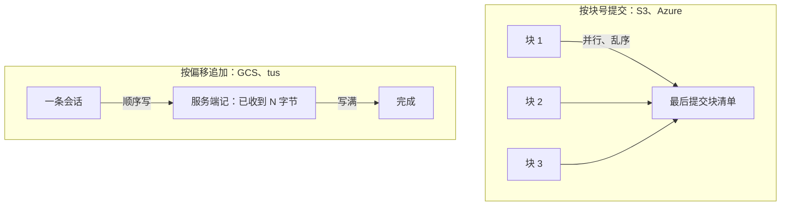

## Q
**大文件 · 可续传上传协议对比：S3、GCS、Azure、tus**｜拓展 · 加分

除了 S3 分段上传，GCS 可续传上传、Azure 块 Blob、开放协议 tus 各怎么做续传？本质区别是什么，怎么选？

## A
- **一句话：** 两种模型。"按块号提交"（S3、Azure）：块可并行、乱序，最后提交一份块清单；"按偏移追加"（GCS、tus）：一条会话顺序写，服务端只记"已收到多少字节"，写满即完成。

| | S3 分段上传 | GCS 可续传上传 | Azure 块 Blob | tus |
|---|---|---|---|---|
| 会话标识 | `UploadId` | 会话 URI（`Location` 头） | 无；blob URL 加自选 `blockid` | 上传 URL（`Location` 头） |
| 开始 | `CreateMultipartUpload` | `POST …?uploadType=resumable` | 直接 `Put Block` | `POST` 带 `Upload-Length`，回 201 |
| 传数据 | `UploadPart`（块号） | `PUT` 带 `Content-Range` | `Put Block`（blockid） | `PATCH` 带 `Upload-Offset` |
| 查进度 | `ListParts` | 空体 `PUT`，`Content-Range: bytes */总长`，回 308 和 `Range` | `Get Block List`（`blocklisttype=uncommitted`） | `HEAD`，回 `Upload-Offset` |
| 完成 | `CompleteMultipartUpload` 带清单 | 最后一段写完自动生成对象 | `Put Block List` 提交 | 偏移到达 `Upload-Length` |
| 并行 | 支持 | 单会话顺序写 | 支持 | 需 Concatenation 扩展 |
| 块限制 | 5 MiB–5 GiB，最多 10,000 块 | 256 KiB 的整数倍（末段除外） | 单块最大 4,000 MiB，最多 50,000 块 | 协议不限 |
| 遗留清理 | 不过期，靠 Abort 或生命周期 | 会话 URI 一周后失效 | 一周没有新块或提交，未提交块被回收 | Expiration 扩展，`Upload-Expires` |

- **按块号提交：** 多连接并行、单块覆盖重传；代价是有人要保存块清单，最后多一次提交。Azure 同一个 blockid 重传，提交时以最后一次为准。
- **按偏移追加：** 状态只有一个数字，续传就是"问偏移、从偏移接着传"；GCS 会丢弃已持久化偏移之前的重复字节，tus 的 `Upload-Offset` 与服务端不符直接回 409。代价是单会话吞吐受一条连接限制。
- **凭证形态：** S3 每块一个预签名 URL；GCS 的会话 URI 本身就是凭证，持有者无需再认证就能往目标桶写，只能交给发起的那个客户端；Azure 用 SAS 令牌；tus 由你的上传服务（如 tusd）鉴权，字节先到你的服务再写进存储。
- **怎么选：** 已在某家云上，就用它的原生协议加签名 URL，字节不经你的服务器；要跨云、对接自建存储或统一客户端（如 Uppy），用 tus，代价是自己承担上传带宽。
