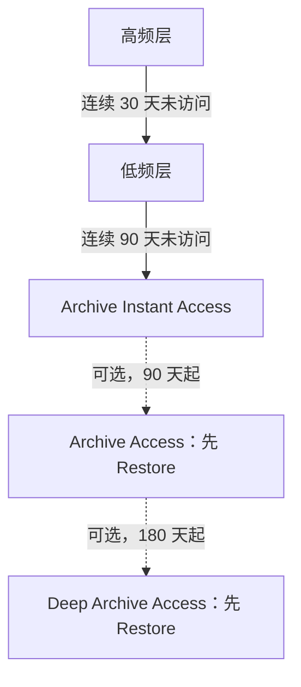

## Q
**大文件 · S3 存储类别：按访问频率分层**｜拓展 · 加分

视频平台每天新增几百 TB，大多数视频发布几周后就几乎没人看。S3 有哪些存储类别，各自用存储费换掉了什么？

## A
- **一句话：** 越冷的类别每 GB 存储越便宜，换来的是取回费、最短计费期、最小计费大小，最冷的两档还要先恢复（Restore）才能读；访问模式说不准时用 Intelligent-Tiering 让 S3 按对象自动挪。

| 类别 | 适合 | 读取 | 最短计费期 | 最小计费大小 |
|---|---|---|---|---|
| Standard | 每月多次访问 | 毫秒 | 无 | 无 |
| Intelligent-Tiering | 访问模式未知或会变 | 毫秒（可选归档层除外） | 无 | 无 |
| Standard-IA | 约每月一次 | 毫秒，按 GB 收取回费 | 30 天 | 128 KB |
| One Zone-IA | 可重建的数据，只存一个可用区 | 毫秒，取回费 | 30 天 | 128 KB |
| Glacier Instant Retrieval | 约每季度一次 | 毫秒，取回费 | 90 天 | 128 KB |
| Glacier Flexible Retrieval | 约每年一次 | 先 Restore，分钟到小时 | 90 天 | 每对象另计 40 KB 元数据 |
| Glacier Deep Archive | 少于每年一次 | 先 Restore，小时级 | 180 天 | 每对象另计 40 KB 元数据 |

- **Intelligent-Tiering 怎么动：** 新对象进高频层；连续 30 天没被访问降到低频层，连续 90 天降到 Archive Instant Access 层，三层都是毫秒读、没有取回费。可另开 Archive Access（90 天起）和 Deep Archive Access（180 天起）两个归档层，进去后要先 Restore。代价是按对象收每月监控费；小于 128 KB 的对象不监控，永远在高频层。

- **最短计费期：** 进了 Standard-IA 第 10 天就删，仍按 30 天收；Glacier Instant Retrieval 和 Flexible Retrieval 是 90 天，Deep Archive 是 180 天。
- **最小计费大小：** IA 和 Glacier Instant Retrieval 中小于 128 KB 的对象按 128 KB 收；Flexible Retrieval 和 Deep Archive 每个对象额外占 40 KB（8 KB 按 Standard 价、32 KB 按归档价），海量小文件先打包再归档。
- **归档类不能在线读：** Flexible Retrieval 和 Deep Archive 的对象要先 `RestoreObject` 生成临时副本，恢复期间副本另按 Standard 计费；所以要被 CDN 回源、在线播放的内容不能放这两类。
- **可用区：** One Zone-IA 只存一个可用区，可用区物理损毁会丢数据，只放能重建的东西（如可以重新转码的低档清晰度）；其余类别至少跨 3 个可用区。
- **取回费的风险：** 老视频突然翻红，IA 和 Glacier Instant Retrieval 会按读出量收取回费；访问说不准时 Intelligent-Tiering 更稳。
