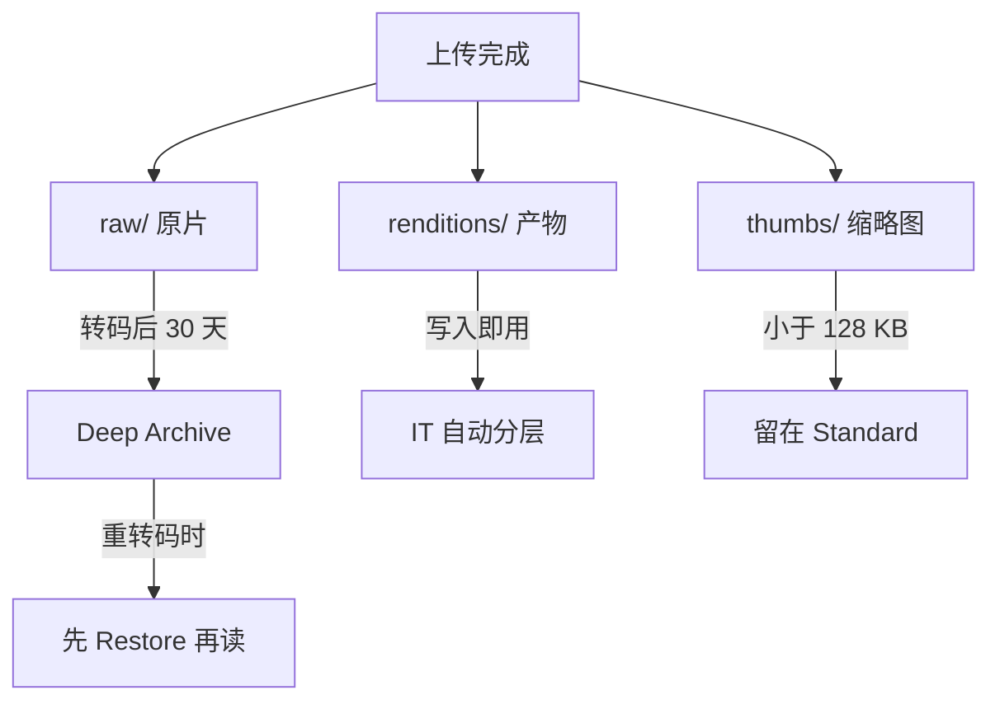

## Q
**大文件 · 生命周期规则：让冷视频自动降级**｜拓展 · 加分

视频平台的原片、转码产物、缩略图冷热各不相同。怎样用 S3 生命周期规则自动把它们挪到合适的存储类别或删掉？规则有哪些限制和坑？

## A
- **一句话：** 生命周期规则（lifecycle configuration）是桶上的配置，按前缀、标签或对象大小筛对象，到了指定天数由 S3 异步执行"转换类别"或"到期删除"；按数据用途分前缀，每个前缀一条规则。

- **规则长什么样：**
  `{"ID": "raw-archive", "Filter": {"Prefix": "raw/"}, "Status": "Enabled", "Transitions": [{"Days": 30, "StorageClass": "DEEP_ARCHIVE"}]}`
  同一份配置里还应有一条 `AbortIncompleteMultipartUpload` 规则，清理没提交的分段上传。
- **动作两类：** `Transition` 按对象年龄改类别；`Expiration` 到期删除（开了版本控制时还有针对旧版本的动作）。
- **只能往冷的方向走：** 支持的转换是一个"瀑布"：Standard 可转到任何更冷的类别，Glacier Flexible Retrieval 只能再转 Deep Archive，Deep Archive 是终点。反方向要先 Restore，再复制成新类别。
- **小对象默认不转：** 每转换一个对象收一次请求费，小对象省下的存储费抵不过；2024 年 9 月起默认不转换小于 128 KB 的对象，要转得用对象大小筛选（`ObjectSizeGreaterThan` / `ObjectSizeLessThan`）显式放开。
- **最短计费期也约束规则：** 不能在一条规则里写"4 天后转 Glacier Instant Retrieval、20 天后转 Deep Archive"，后一次转换至少要在第 94 天；拆成两条规则可以，但要付最短计费期的钱。
- **计费从规则满足那天算：** 转到 Flexible Retrieval 或 Deep Archive 是异步的，实际搬运可能有延迟，但按目标类别计费从规则满足的那天开始。
- **视频平台的取舍：** 原片只在换编码格式、重新转码时才读，归档到 Deep Archive，或评估后干脆删除；转码产物由 CDN 回源，必须毫秒可读，交给 Intelligent-Tiering（图中 IT）；缩略图通常小于 128 KB，留在 Standard。
