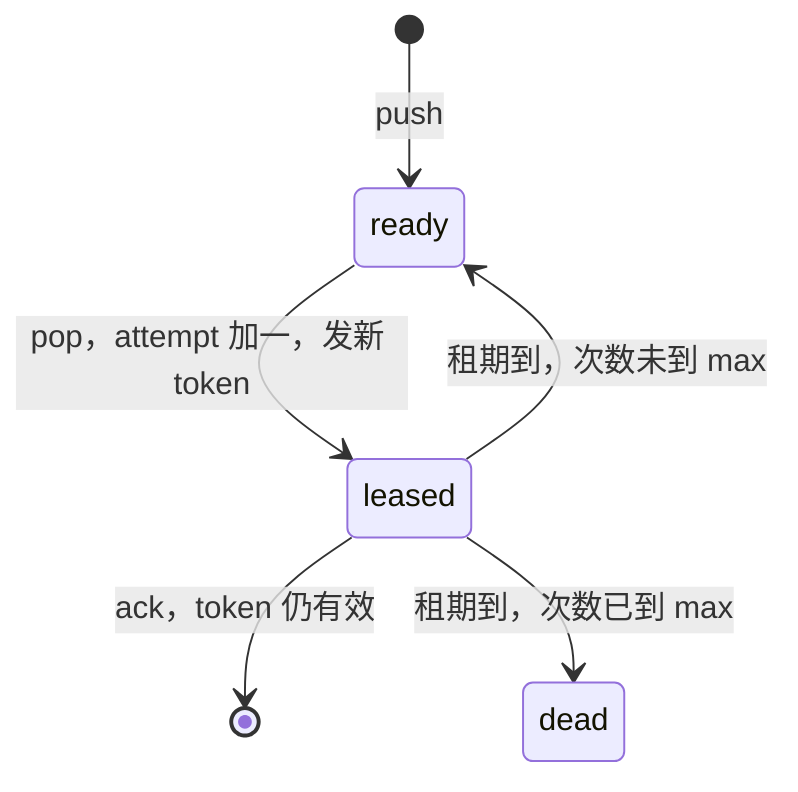

## Q
**长任务 · Python：带租期的至少一次队列**｜拓展 · 加分

SQS 的可见性超时到底做了什么？手写一个能说明"迟到的旧工作者"问题的最小版本。

## A
**模式。** 租约（lease）加围栏令牌（fencing token）：取走只是借用，要在租期内确认。

```python
import heapq
import itertools
import time
from dataclasses import dataclass, field
from typing import Callable, Optional

@dataclass(order=True)
class _Lease:
    deadline: float
    job_id: str = field(compare=False)
    token: int = field(compare=False)

class LeaseQueue:
    def __init__(self, lease: float = 30.0, max_attempts: int = 3,
                 clock: Callable[[], float] = time.monotonic) -> None:
        self._clock = clock                      # 注入时钟，测试不必真的等待
        self._lease, self._max = lease, max_attempts
        self._ready: list[str] = []
        self._leases: list[_Lease] = []          # 按到期时间排序的小顶堆
        self._live: dict[str, int] = {}          # job_id -> 当前有效 token
        self._attempts: dict[str, int] = {}
        self.dead: list[str] = []                # 死信
        self._tok = itertools.count(1)

    def push(self, job_id: str) -> None:
        self._ready.append(job_id)

    def _reap(self) -> None:
        now = self._clock()
        while self._leases and self._leases[0].deadline <= now:
            lease = heapq.heappop(self._leases)
            if self._live.get(lease.job_id) == lease.token:   # 已确认或已换租约的记录忽略
                del self._live[lease.job_id]
                dest = self.dead if self._attempts[lease.job_id] >= self._max else self._ready
                dest.append(lease.job_id)

    def pop(self) -> Optional[tuple[str, int]]:
        self._reap()
        if not self._ready:
            return None
        job = self._ready.pop(0)
        self._attempts[job] = self._attempts.get(job, 0) + 1
        tok = next(self._tok)
        self._live[job] = tok
        heapq.heappush(self._leases, _Lease(self._clock() + self._lease, job, tok))
        return job, tok

    def ack(self, job_id: str, token: int) -> bool:
        # 令牌防止租期已过、任务已被别人接手的旧工作者确认成功
        if self._live.get(job_id) == token:
            del self._live[job_id]
            return True
        return False
```



- **至少一次：** 工作者崩溃或停顿过长，租期到后任务重新可取，所以任务可能被执行不止一次，必须幂等。
- **令牌的作用：** 旧工作者醒来后用旧令牌确认会失败，不会把已被新工作者接手的任务标成完成；但它的副作用已经发生，真正的保护还是幂等。
- **注入时钟：** 测试直接拨动 `clock`，不用 `sleep`，快且确定。
- **取舍：** 租期要大于正常处理时间，否则健康任务被重复分发；处理时间不定就让工作者续租（心跳延长租期）。
