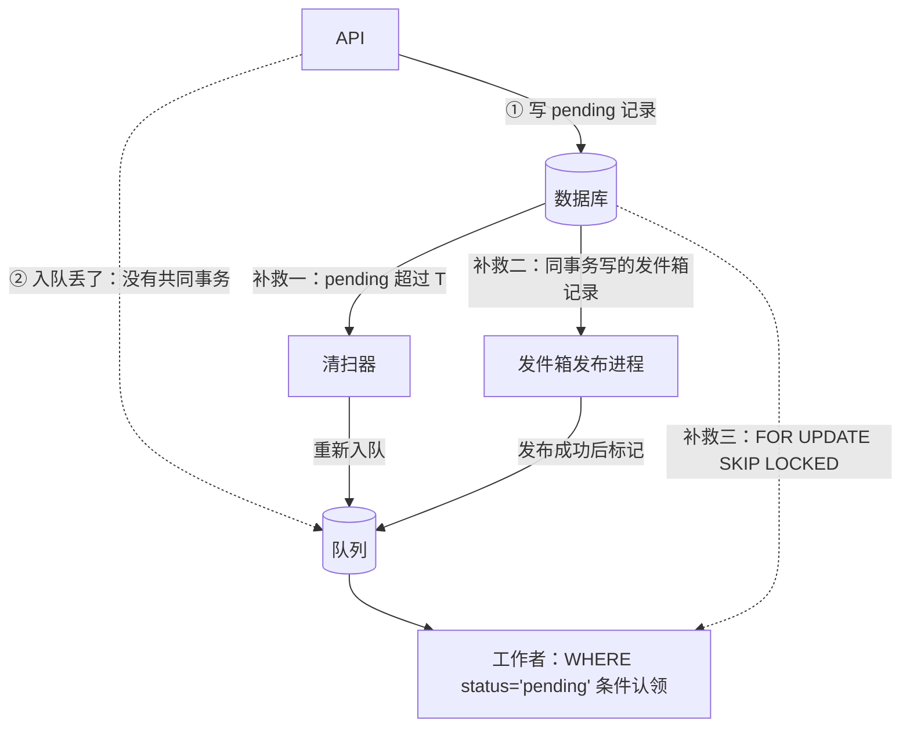

## Q
**长任务 · 先写库再入队的缝隙**｜拓展 · 加分

创建任务记录之后、入队之前服务器崩了，会怎样？怎么堵上？

## A
- **问题（双写）：** 数据库里有 pending 记录但队列里没有消息，任务永远没人处理，用户看到的是永远排队。数据库和队列没有共同的事务。
- **补救一，清扫器（sweeper）：** 周期任务找出停在 pending 超过 T 的记录，重新入队。因为可能与正常入队重复，所以工作者认领任务要用条件更新（`WHERE status = 'pending'`）防止两个人处理，且任务要幂等。
- **补救二，事务性发件箱（transactional outbox）：** 在同一数据库事务里写任务记录和一条待发消息，另一个进程把发件箱记录发布到队列，发布成功后标记。
- **补救三，直接用数据库当队列：** `SELECT ... FOR UPDATE SKIP LOCKED` 认领任务，没有双写问题，适合中小规模。

- **面试说法：** 提到"队列挂了任务在数据库里堆着"时，顺便说清它们是怎么被重新捡起来的。
