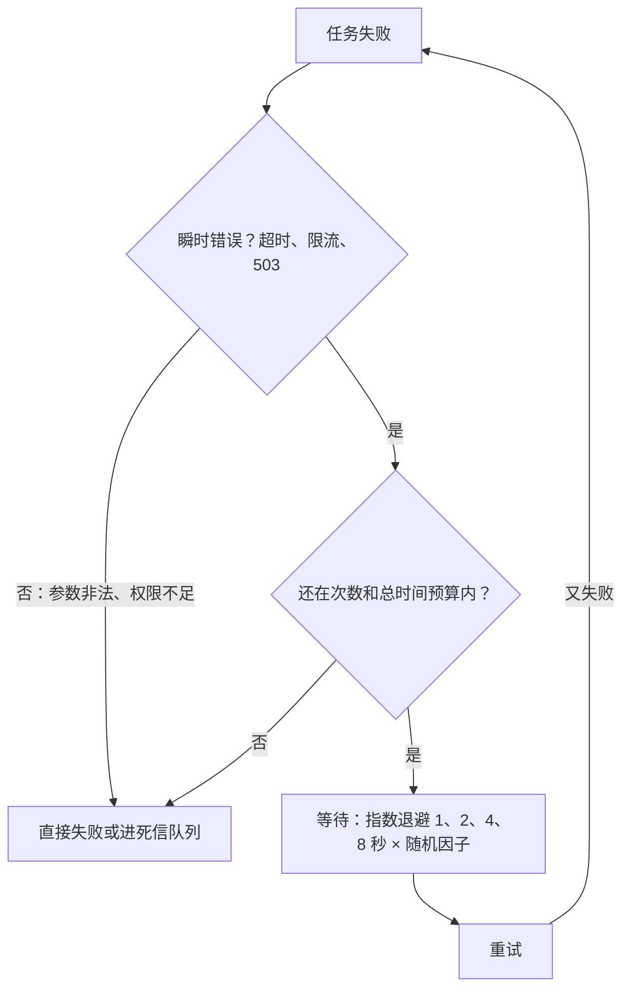

## Q
**长任务 · 重试的退避与抖动**｜拓展 · 加分

任务失败后立即重试有什么问题？一个合理的重试策略怎么定？

## A
- **立即重试的问题：** 下游服务过载导致失败时，立刻重试只会加重过载；大量任务同时失败又同时重试，形成重试风暴。
- **指数退避加抖动：** 等待时间按尝试次数指数增长（如 1、2、4、8 秒），再乘以随机因子，让重试时刻错开。队列通常有延迟投递的功能来实现。
- **区分失败类型：** 瞬时错误（超时、限流、503）才重试；永久错误（参数非法、权限不足）直接失败或进死信队列，别白白消耗重试次数。
- **有预算：** 限制最大次数和总重试时间，否则下游宕机时积压的重试会在恢复瞬间一起冲击它。

- **配合幂等：** 超时的请求可能已经成功，重试要能安全重复。
