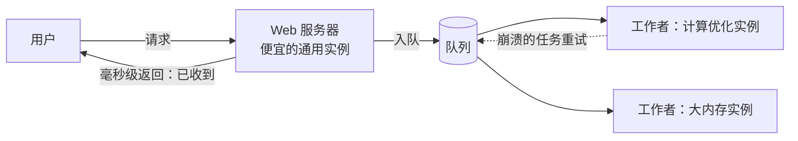

## Q
**长任务 · 收益**｜摘要 · 必会

采用异步工作者池能得到哪些好处？

## A
- **响应快：** API 毫秒级返回，而不是 30 秒后超时，用户立刻知道请求已收到。
- **独立扩展：** Web 服务器和工作者分别扩缩，高峰处理期多加工作者，不必为空闲的 Web 服务器付费。
- **故障隔离：** 处理某个视频的工作者崩了不会拖垮整个 API，失败的任务可以重试而不影响面向用户的服务。
- **资源利用更好：** CPU 密集的工作者用计算优化实例，吃内存的任务用大内存机器，Web 服务器用便宜的通用实例。

