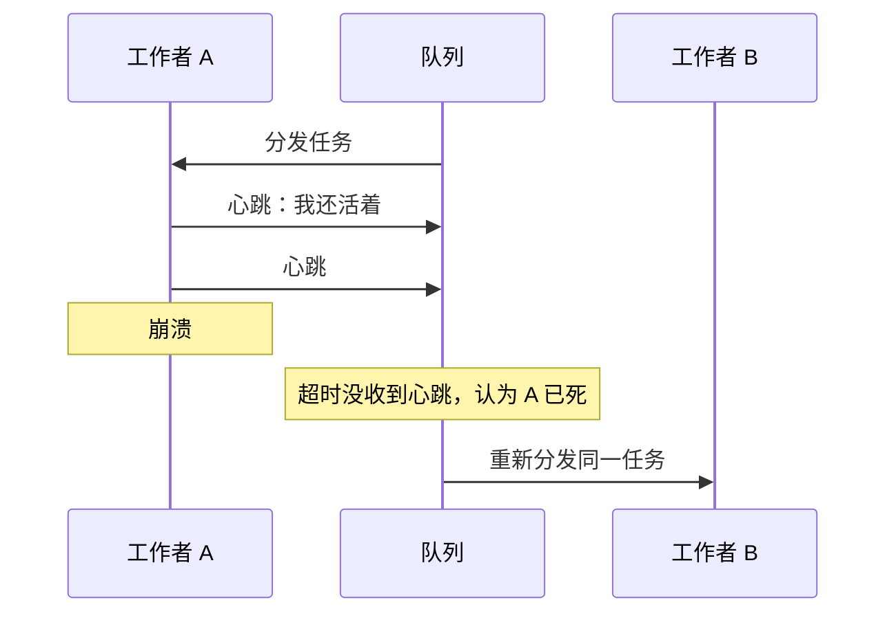

## Q
**长任务 · 追问：工作者处理中崩溃怎么办**｜摘要 · 追问

工作者处理任务时崩了，队列怎么知道、任务怎么恢复？心跳间隔怎么定？

## A
- **恢复：** 任务由另一个工作者重试。
- **怎么发现崩溃：** 心跳机制（heartbeat）：工作者定期向队列报到表明自己活着，队列在没收到时认为它已死亡并重新分发任务。

- **间隔太长：** 崩溃会让任务延迟很久，队列会乐观地认为工作者还活着。
- **间隔太短：** 向队列发太多无谓消息；更糟的是把仍在运行的任务误判为失败，例如垃圾回收暂停期间。
- **各系统的叫法：** SQS 的可见性超时（visibility timeout）、RabbitMQ 的心跳间隔、Kafka 的会话超时（session timeout）。选择用户能容忍的额外延迟范围内尽量长的间隔，多数系统以 10 到 30 秒为起点。
