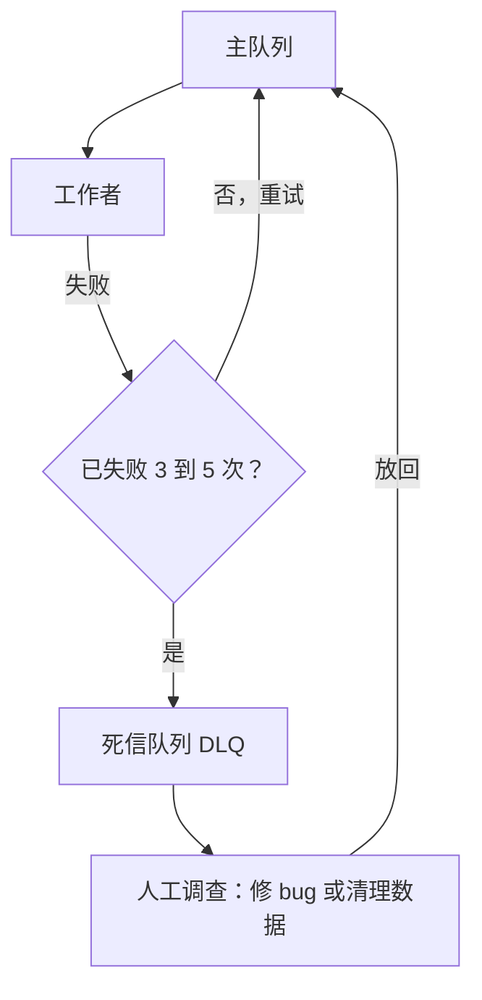

## Q
**长任务 · 追问：任务反复失败怎么办**｜摘要 · 追问

代码有 bug 或输入数据有毒，任务每次都让工作者崩溃，会怎样？怎么办？

## A
- **不处理的后果：** 失败任务无限重试，工作者把时间浪费在注定失败的任务上，正常工作积压；毒消息（poison message）还可能让整个工作者集群一个接一个崩溃。
- **死信队列**（Dead Letter Queue，DLQ）：任务失败一定次数（通常 3 到 5 次）后，不再重试，而是移到单独的队列。这样隔离了问题任务，健康工作继续。DLQ 里是需要人工调查的任务，修好 bug 或清理数据后可以放回主队列重新处理。

- **各系统的配置：** SQS 配置重驱动策略（redrive policy）；RabbitMQ 设置死信交换机（dead letter exchange）。
- **要监控：** DLQ 持续增长通常意味着系统里有需要立即处理的 bug。
