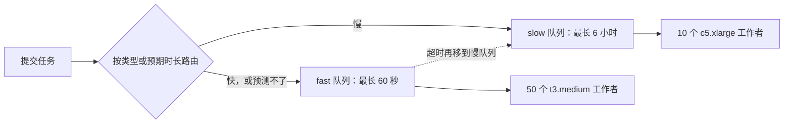

## Q
**长任务 · 追问：快任务和慢任务混在一个队列**｜摘要 · 追问

有的报告 5 秒，年终报告 5 小时，放在同一个队列会怎样？

## A
- **问题：** 长任务阻塞短任务（队头阻塞，head-of-line blocking）：想要简单报告的用户排在年终大导出后面等数小时。工作者利用率不均，一些工作者处理几百个快任务，另一些被单个长任务卡住；任务时长无法预测，自动扩容也很痛苦。
- **解决：按类型或预期时长分队列：** 快速报告进"fast"队列配大量工作者；复杂报告进"slow"队列配少量更强的工作者。两个队列可分别调优，比如快队列最长 60 秒、50 个 t3.medium 工作者，慢队列最长 6 小时、10 个 c5.xlarge 工作者。
- **替代做法：** 把大任务拆成小块仍用同一套队列基础设施，比如把信息流扇出拆成按粉丝批次。
- **路由：** 提交时路由到合适的队列；时长预测不了就先放快队列，超时再移到慢队列。

