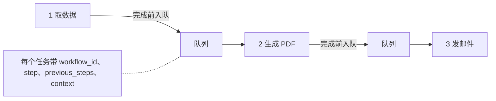

## Q
**长任务 · 追问：任务之间有依赖**｜摘要 · 追问

生成报告要三步：取数据、生成 PDF、发邮件。怎么编排有依赖的任务？

## A
- **不编排的后果：** 工作者做完第 1 步直接排第 2 步，流程难读难改，错误处理很难（第 2 步失败是只重试这一步还是从头来？），看哪一步为什么失败要翻日志。
- **简单链：** 每个工作者在标记自己完成前先把下一个任务入队，每个任务带上完整上下文（`workflow_id`、当前 `step`、`previous_steps`、`context`），这样每一步可独立重试。

- **复杂工作流（有分支、并行）：** 用工作流编排器，如 AWS Step Functions、Temporal 或 Airflow，用代码定义工作流、按步骤重试，并能看到卡在哪一步。代价是额外的复杂度，依赖变复杂才引入。
- **延伸：** 详见多步流程模式。
