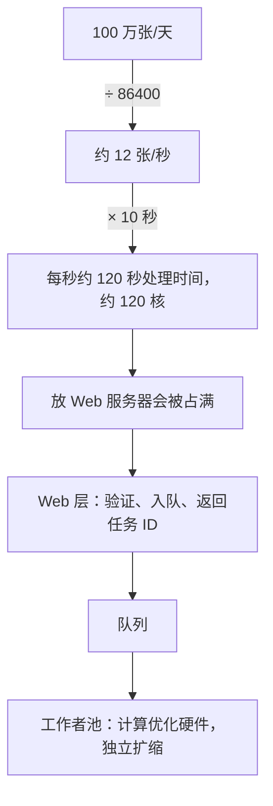

## Q
**长任务 · 每天一百万张图的算术**｜考点 · 必会

面试官说"每天处理 100 万张图片，每张处理 10 秒"，你怎么用这个数字推出设计？

## A
- **算：** 100 万 / 86400 ≈ 12 张每秒，每秒要 12 × 10 = 约 120 秒的处理时间，也就是大约要 120 个核持续处理（峰值更多）。
- **结论：** 放在 Web 服务器上会把它们占满，无法服务用户。
- **设计：** 上传后入队，工作者池独立扩缩，部署在计算优化硬件上；Web 层只验证、入队、返回任务 ID。

- **加分：** 估算峰值是平均的几倍，用队列深度驱动扩容，并说明用户怎么知道处理完成。
