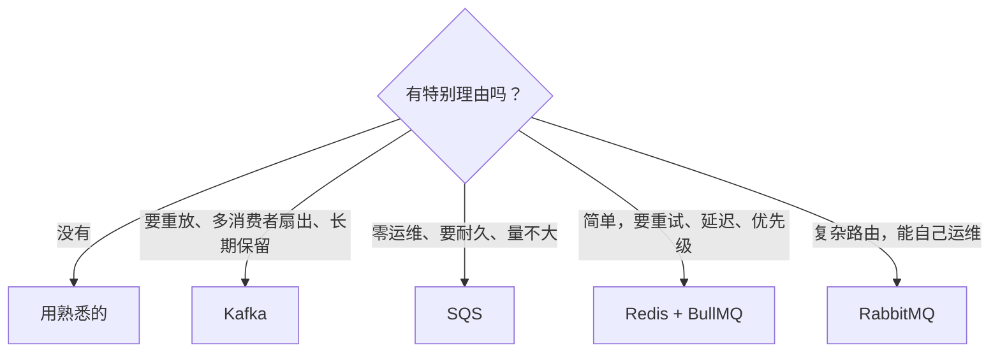

## Q
**长任务 · 队列选型**｜考点 · 必会

面试官问"为什么选 Kafka，不选 SQS 或 Redis"，怎么答？

## A
- **没有特别理由就用熟悉的：** 面试中别在队列优劣上纠缠，重点展示职责分离。
- **Kafka：** 技术栈已有事件流，需要重放、多消费者扇出、长期保留，量大且分区内有序。
- **SQS：** 想零运维、要耐久，量不大时划算；消息上限 1MB，只传 ID。
- **Redis + BullMQ：** 简单，自带重试、延迟任务、优先级；以内存为主，硬崩溃可能丢任务。
- **RabbitMQ：** 需要复杂路由，能接受自己运维。

- **加分：** 任务队列常需要按任务单独重试、延迟、死信，Kafka 本身没有"单条消息重试"的语义，要自己做重试主题；这是选 SQS 或 BullMQ 的合理理由。
