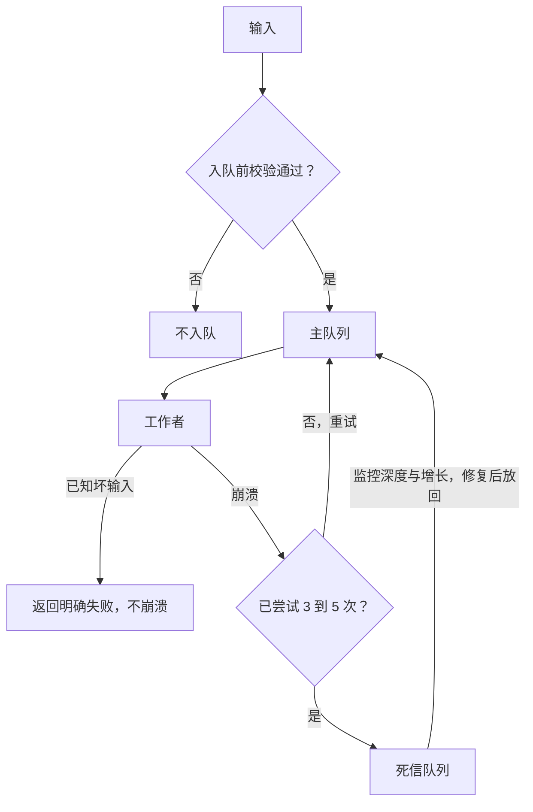

## Q
**长任务 · 毒消息**｜考点 · 必会

一条脏数据让工作者每次处理都崩，集群在不断重启。怎么止血、怎么长期治理？

## A
- **止血：** 设最大尝试次数（3 到 5 次），超过就移入死信队列，不再重试；其余任务继续。
- **长期：** 监控 DLQ 的深度和增长速度，增长意味着有 bug；人工排查修复后可以把任务放回主队列。
- **预防：** 入队前校验输入；工作者对已知的坏输入返回明确失败，而不是崩溃。

- **配置：** SQS 的重驱动策略，RabbitMQ 的死信交换机。
