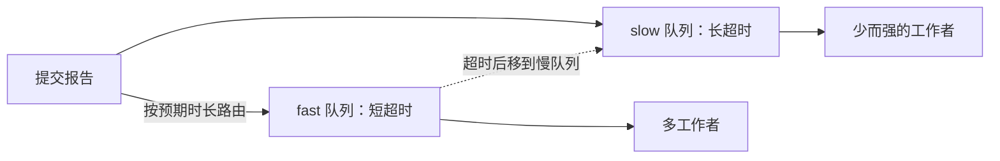

## Q
**长任务 · 队头阻塞**｜考点 · 必会

一个年终大导出占住了所有工作者，普通用户的小报告等了几小时。怎么改？

## A
- **按时长或类型拆队列：** fast 队列多工作者短超时，slow 队列少而强的工作者长超时，互不影响。
- **路由：** 提交时按预期时长路由；预测不了就先进快队列，超时后移到慢队列。
- **替代：** 把大任务拆成小块，在同一队列里并行处理。
- **好处：** 每个队列可独立调优和扩缩，自动扩容也更好预测。

