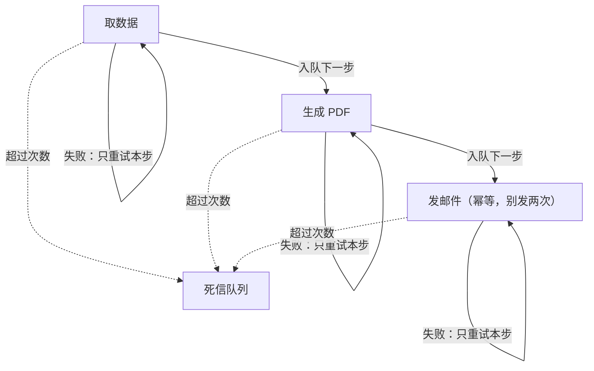

## Q
**长任务 · 三步报告的编排**｜考点 · 必会

取数据、生成 PDF、发邮件三步，某一步失败怎么办？什么时候该上工作流引擎？

## A
- **简单链：** 每步完成后把下一步入队，任务携带完整上下文（工作流 ID、当前步骤、前序步骤、数据位置），每步可独立重试，不必从头来。
- **失败：** 按步骤独立重试，超过次数进死信队列；各步要幂等（邮件别发两次）。

- **何时上编排器：** 出现分支、并行、需要看到卡在哪步、补偿时，用 Step Functions、Temporal、Airflow。
- **面试判断：** 依赖简单别上；依赖复杂才引入，并说明增加的复杂度。
