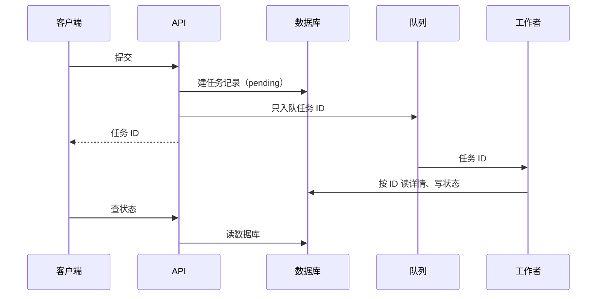

## Q
**长任务 · 队列里放 ID 还是放数据**｜考点 · 必会

为什么提交流程是"数据库建任务记录，再把任务 ID 入队"，而不是把全部数据放进消息？

## A
- **消息大小：** SQS 单条消息上限 1MB，大数据放不下。
- **唯一权威数据源：** 任务状态和详情以数据库为准，消息只是触发信号，重试、重复投递不会带来不一致的数据副本。

- **可观测：** 状态查询接口读数据库就行。
- **失败时：** 队列挂了，请求仍被接受，任务在数据库里以 pending 堆着，等恢复后可以重新入队。
