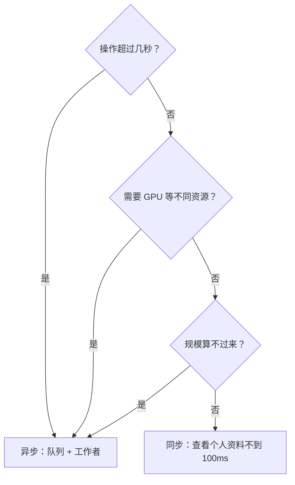

## Q
**长任务 · 什么时候不需要异步**｜考点 · 必会

面试官让你设计"查看个人资料"，你要不要加队列和工作者？

## A
- **不要：** 一次数据库查询加格式化，不到 100ms，同步足够，用户几乎无感。
- **异步的成本：** 队列、工作者、状态追踪、监控、最终一致，复杂度不值得。
- **判断标准：** 操作超过几秒、资源不匹配（需要 GPU 等）、或规模算不过来才引入。

- **加分：** 在需要用户立刻看到结果的场景（交互式预览）异步反而破坏体验。
