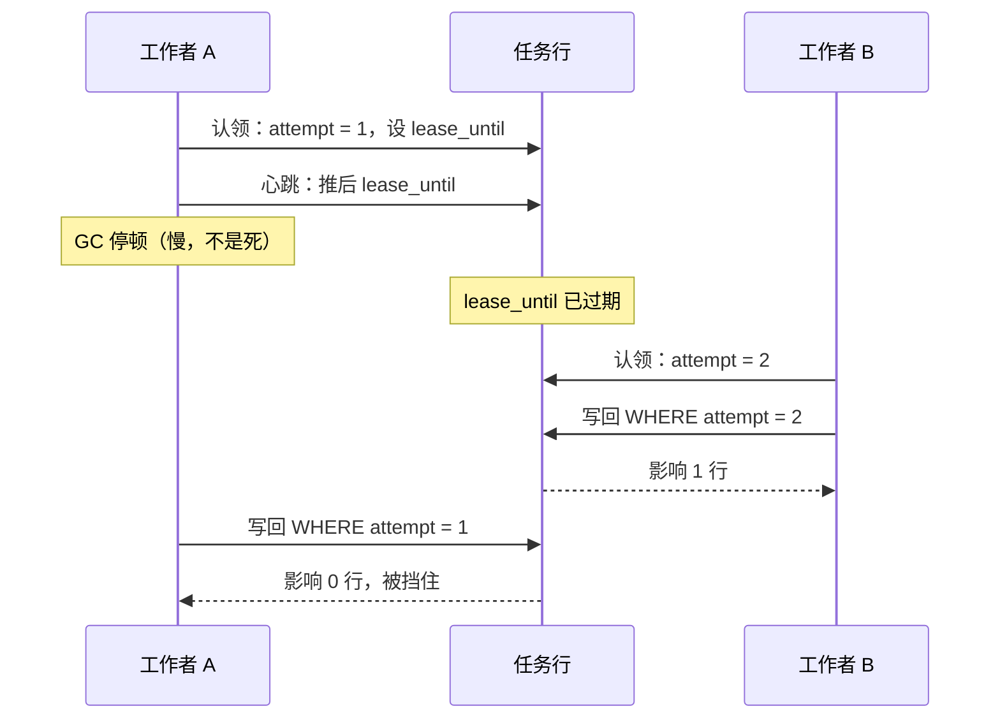

## Q
**长任务 · 工作者死了：谁发现、谁把任务交给别人**｜拓展 · 必会

工作者处理任务时进程崩了。到底是谁发现它死了：心跳、租约，还是队列本身？又是谁把它的任务交给另一个工作者？对比 SQS、Kafka 消费者组、数据库租约、Temporal 四种做法。

## A
死掉的进程什么也报告不了，所以没人「看到」它死，只能由**持有任务状态的一方**发现「约定的时间到了，却没收到续期或结果」。租约是带到期时间的「这件事归你」记录，心跳是持有者定期把到期时间往后推（续租）。四种做法只在三件事上不同：到期记在谁那里，心跳续的是一条任务还是整个成员资格，到期后谁把任务交出去。

| 机制 | 到期记在哪 | 心跳续的是什么 | 谁发现、谁转交 |
|---|---|---|---|
| SQS 可见性超时 | 在途消息的隐身计时 | 这一条消息：`ChangeMessageVisibility` | 没有检测者，计时到期消息自动重新可见，下一个 `ReceiveMessage` 的任意工作者取走 |
| Kafka 消费者组 | 组协调者上的成员会话 | 整个成员资格：后台线程心跳 | 协调者在 `session.timeout.ms` 内没心跳，或两次 `poll()` 超过 `max.poll.interval.ms`，发起再均衡，把**整个分区**交给别人，从已提交位移重读 |
| 数据库租约 | 任务行的 `lease_until` | 这一行：`UPDATE … SET lease_until = now() + …` | 没有检测者，认领 SQL（`FOR UPDATE SKIP LOCKED`）把 `lease_until < now()` 的行当作可取，`attempt + 1` |
| Temporal Activity | Server 上这次尝试的计时器 | 这一次尝试：Activity 心跳，可带进度 | Server 在心跳超时或 Start-To-Close 到期时按重试策略放回任务队列 |

- **多快：** 恢复延迟约等于超时长度：SQS 默认 30 秒；Kafka 会话 45 秒，处理卡住要等 `max.poll.interval.ms`（默认 5 分钟）；租约和 Temporal 自己设。超时越短发现越快，但 GC 停顿、网络抖动会被误判为死亡。
- **僵尸（慢，不是死）：** 超时只是猜它死了，四种做法都会让同一任务执行两次，区别是晚到的结果被不被接受。SQS：旧句柄的 `DeleteMessage` 返回成功但消息可能没被删，输出照常落地。Kafka：被移出组后提交位移失败，已产生的副作用收不回，且影响整个分区。数据库租约：写回带 `WHERE attempt = 我的 attempt`，旧尝试影响 0 行（`attempt` 就是围栏令牌）。Temporal：旧尝试的完成回报被拒，但旧代码对外部的写入仍会发生。

- **共同结论：** 能挡住晚到的状态写回，挡不住晚到的外部副作用，所以输出必须幂等：确定性路径、去重键、条件写。
- **怎么选：** 单步任务用 SQS；多步、有依赖、要看进度的长流程用 Temporal；已有 PostgreSQL 且规模中小用数据库租约；Kafka 消费者组适合短小、按键有序的事件，不适合每条十分钟的任务。
