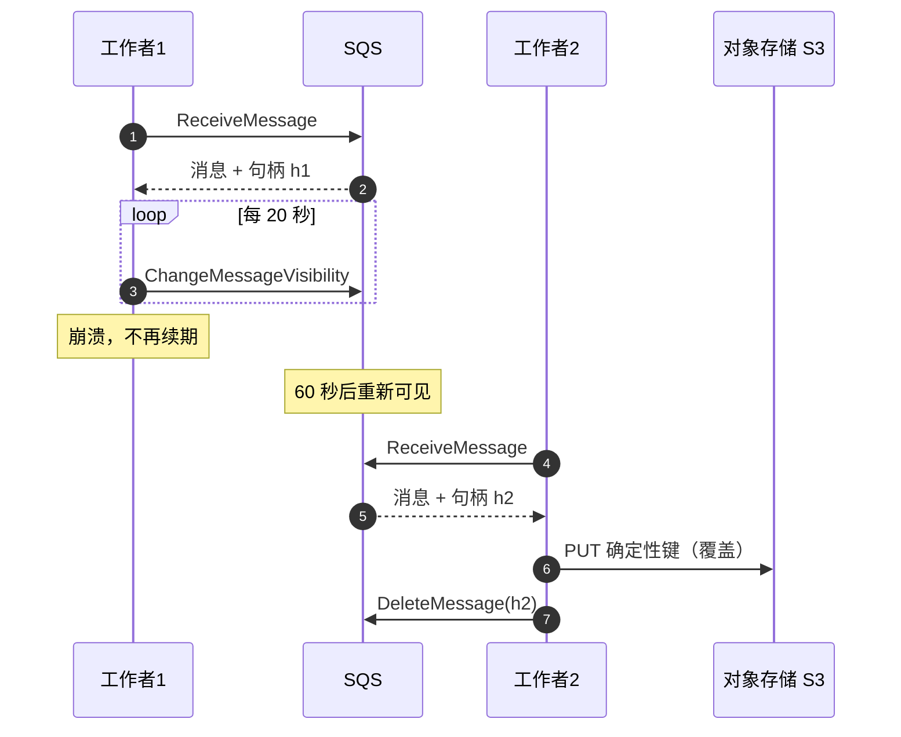

## Q
**长任务 · SQS 可见性超时：消息怎样从死掉的工作者转给别人**｜拓展 · 必会

一个转码任务要 10 分钟。用 SQS 时，工作者中途崩溃，消息怎样回到别人手里？没有单独的心跳服务，长任务又怎样避免被误判为失败？

## A
SQS 不知道消费者是谁、是否活着。`ReceiveMessage` 交出消息的同时让它对别人隐身一段时间（可见性超时）；期间 `DeleteMessage` 就算完成，没删则到期自动重新可见。长任务靠工作者定期 `ChangeMessageVisibility` 往后推隐身时间，这个调用就是心跳。

- **续期绑在真实进展上：** 每完成一块（如一段帧）用当前回执句柄 `h1` 调 `ChangeMessageVisibility(VisibilityTimeout=60)`，间隔取超时的约 1/3，丢一次续期也不会过期；不要另起与工作无关的定时线程，否则卡死的任务会被永远续下去。
- **崩溃与转交：** 进程死了续期就停，最后一次续期满 60 秒后消息重新可见；没有组件「发现」崩溃，计时到期本身完成回收。下一个 `ReceiveMessage` 的工作者取到，`ApproximateReceiveCount` 变 2，句柄换成 `h2`。
- **幂等重做：** 输出写到只由任务决定的键（如 `videos/{id}/{rendition}/seg_{n}`），重做只是覆盖；最后用最新句柄 `h2` 删除。
- **反复失败：** 重驱动策略 `maxReceiveCount`，接收次数超限转死信队列；它数的是被接收的次数，主动放回、延后也计入。
- **僵尸工作者：** 卡顿后醒来继续写，确定性的键让内容与新工作者相同；它用旧句柄 `h1` 删除会返回成功但消息可能没被删，所以不能用删除结果判断「任务还归不归我」。
- **主动放手：** 收到 SIGTERM 来不及做完，`ChangeMessageVisibility(VisibilityTimeout=0)` 让消息立刻可见。标准队列至少一次投递，没超时也可能重复，处理必须幂等。
- **为什么不是别的：** 只设 15 分钟长超时省掉续期，但崩溃后要等 15 分钟；短超时加续期让发现时间与任务时长无关。另建健康检查服务要和队列协调转交，多一套组件。
- **数字：** 可见性超时默认 30 秒，上限 12 小时（从**第一次接收**算起，续期不重置，更长任务拆小或交给 Step Functions）；标准队列在途消息约 12 万条上限，超了短轮询返回 `OverLimit`；FIFO 同一消息组有消息在途时组内后续不投递，一个慢任务卡住整个组。
