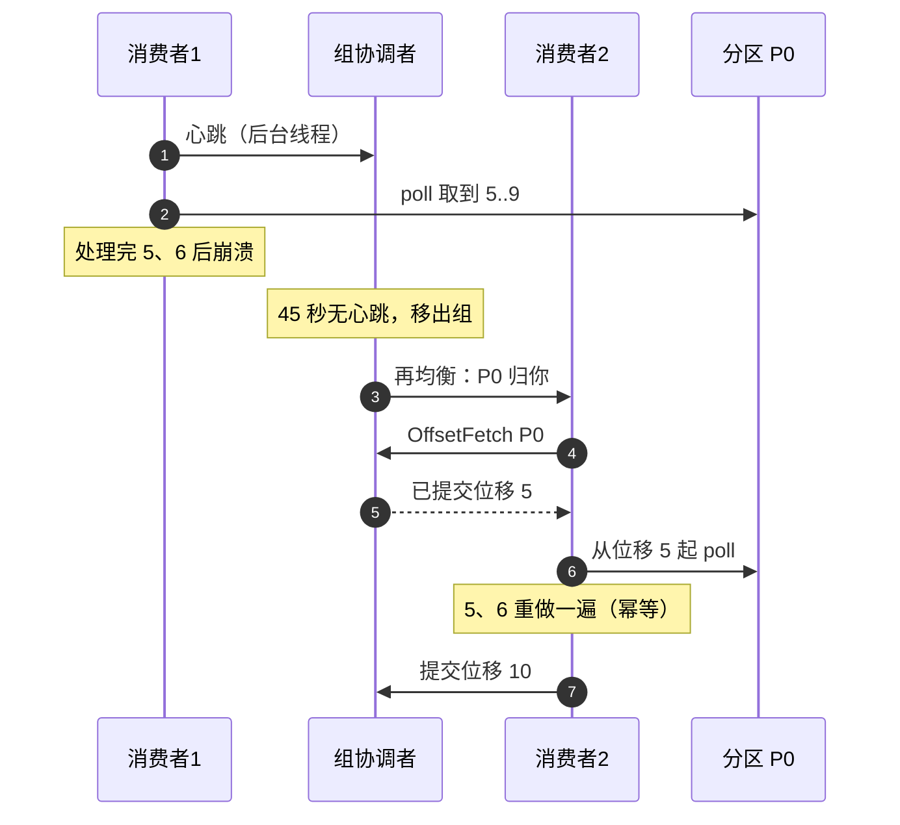

## Q
**长任务 · Kafka 消费者组：谁发现消费者死了、谁接手它的分区**｜拓展 · 必会

工作者是 Kafka 消费者。它死了，是谁发现的？谁把它的工作交给另一个消费者？为什么每条要处理 10 分钟的转码任务不适合放进普通的消费者组？

## A
消费者组里没有「任务」，只有分区。组协调者（负责这个组的那台 broker）把每个分区分给组内一个成员，成员按顺序读并提交位移。心跳续的是**成员资格**，不是某条消息；成员被判死后协调者再均衡（rebalance），把它的**整个分区**交给别人，新成员从最后提交的位移重读，已处理但未提交的消息会再处理一遍。

- **两种存活信号：** 后台线程每 `heartbeat.interval.ms`（3 秒）发心跳，查「进程活着」；主线程拉一批（`max.poll.records` 500 条）处理完要在 `max.poll.interval.ms`（5 分钟）内再 `poll()`，查「还在干活」。
- **谁发现：** 协调者在 `session.timeout.ms`（45 秒）内没心跳就移出该成员；进程活着但处理卡住（心跳线程照发、`poll()` 超时），客户端判定自己失败并主动离组。
- **谁转交：** 协调者发起再均衡，如把 P0 给消费者 2；它查已提交位移 5（提交的是「下一条要读的位置」），5、6 没提交过，从 5 重读，所以处理必须幂等。经典协议由组长客户端算分配，新协议（`group.protocol=consumer`，KIP-848）由协调者在服务端算，会话超时改由 broker 的 `group.consumer.session.timeout.ms`（45 秒）控制，客户端的 `session.timeout.ms` 不再生效。
- **僵尸消费者：** GC 停顿后被移出，醒来继续处理；位移提交会失败，但已写出的副作用收不回，靠幂等输出兜底。
- **长任务的恶性循环：** 一条处理 10 分钟，一批远超 5 分钟的 `max.poll.interval.ms`，被踢出、再均衡、别人从同一位移重做、又超时，全组反复再均衡（再均衡风暴）；调大它或 `max.poll.records=1` 只是缓解，真卡死时要等更久才发现。
- **为什么不适合 10 分钟一条：** 分配单位是分区，一条慢消息挡住后面所有消息（队头阻塞），并行度上限是分区数；位移是单一游标，第 7 条完成而第 5 条在跑时不能单独确认；没有单条重试和死信，要自己转发到重试主题。
- **共享组（share group，KIP-932，Kafka 4.2 起可用）：** 同一分区的消息可同时分给多个消费者，数量可超过分区数；每条取走时加获取锁（`group.share.record.lock.duration.ms` 默认 30 秒，到期重新投递，相当于 SQS 可见性超时；4.2 的 `RENEW` 可延长，相当于 `ChangeMessageVisibility`）；逐条确认（`ACCEPT` / `RELEASE` / `REJECT`），投递满 `group.share.delivery.count.limit`（5）次后归档。代价：不保证顺序，仍是至少一次，处理照样要幂等。
