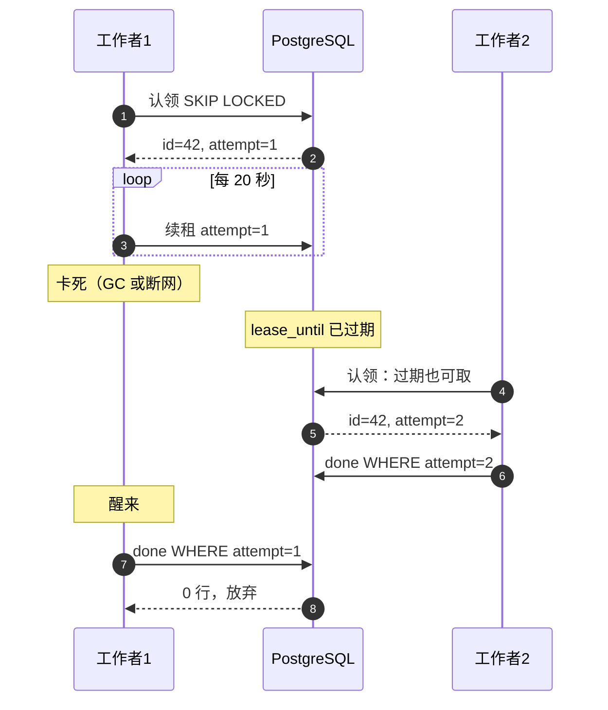

## Q
**长任务 · 数据库租约：一张表当任务队列，并挡住迟到的旧工作者**｜拓展 · 必会

不用消息队列，只用 PostgreSQL 的一张任务表。工作者怎样认领任务、续租？崩溃后谁把任务交给别人？卡顿很久后醒来的旧工作者，为什么不能把结果写坏？

## A
数据库租约把"谁在做、做到什么时候为止"存成任务行上的列。没有专门的检测者：认领 SQL 本身就把"排队中"和"租约已过期"的行都当作可取，崩溃的工作者留下的任务会被下一次认领自然捡走。`attempt` 每次认领加一，既是尝试次数，也是围栏令牌（fencing token）：所有写回都带上它，旧尝试的写入匹配不到行。

```sql
CREATE TABLE jobs (
  id          bigint PRIMARY KEY,
  status      text NOT NULL,             -- queued / running / done / failed
  owner       text,
  lease_until timestamptz,
  attempt     int NOT NULL DEFAULT 0,
  run_after   timestamptz NOT NULL DEFAULT now()   -- 退避后最早可取的时间
);

-- 认领：排队中的，或租约已过期的；跳过别人正锁着的行
UPDATE jobs
SET status = 'running', owner = $worker,
    lease_until = now() + interval '60 seconds',
    attempt = attempt + 1
WHERE id = (
  SELECT id FROM jobs
  WHERE run_after <= now() AND attempt < 5
    AND (status = 'queued'
         OR (status = 'running' AND lease_until < now()))
  ORDER BY run_after
  LIMIT 1
  FOR UPDATE SKIP LOCKED)
RETURNING id, attempt;

-- 续租和完成都带上自己的 attempt；影响 0 行 = 任务已不归我，立刻停手
UPDATE jobs SET lease_until = now() + interval '60 seconds'
WHERE id = $id AND attempt = $my_attempt AND status = 'running';

UPDATE jobs SET status = 'done', lease_until = NULL
WHERE id = $id AND attempt = $my_attempt AND status = 'running';
```



**步骤**
1. **认领：** 工作者1 执行认领 SQL。`FOR UPDATE SKIP LOCKED` 让并发认领的工作者跳过别人正锁着的行，各拿各的，不排队。
2. **拿到令牌：** 返回 `id=42, attempt=1`，`lease_until` 为数据库时间加 60 秒。
3. **续租：** 每完成一块工作就续租一次，间隔约租期的 1/3（20 秒），连丢两次续租也不会过期。
4. **卡死：** 工作者1 停顿或断网，续租停止。
5. **过期：** `lease_until` 落在 `now()` 之前。没有人"发现"这件事，行只是变得可被认领。
6. **转交：** 工作者2 的认领 SQL 匹配到这行（`status = 'running' AND lease_until < now()`）。
7. **新令牌：** `attempt` 变成 2。
8. **完成：** 工作者2 用 `attempt = 2` 写完成，成功。
9. **旧工作者醒来：** 工作者1 不知道自己已失去任务。
10. **晚到的写回：** 它用 `attempt = 1` 写完成。
11. **被围栏挡住：** 影响 0 行，工作者1 放弃这次结果。

**故障与处理**
- **反复失败：** 认领条件带 `attempt < 5`；一个清扫语句把 `attempt >= 5` 且租约过期的行改成 `failed` 并告警，这就是表里的死信。
- **退避：** 可重试的失败写 `status = 'queued', run_after = now() + 退避时长`（带 `WHERE attempt = $my_attempt`），认领条件自然跳过还没到时间的行。
- **围栏只管数据库里的写：** 旧工作者写到对象存储的文件挡不住，所以输出键要确定（覆盖相同内容），或产物路径带上 `attempt`，完成时记下哪次尝试胜出，下游只读胜出的那份。
- **时钟：** 到期判断全用数据库的 `now()`，只有一个时钟，避免工作者之间的时钟漂移让人提前抢走仍在执行的任务。

**为什么这样，不那样**
- **先 `SELECT` 再 `UPDATE`，不加锁：** 两个工作者读到同一行、都认为自己抢到了。
- **只用 `FOR UPDATE` 不加 `SKIP LOCKED`：** 所有认领者在同一行上排队等锁。
- **只记 `owner` 不记 `attempt`：** 同一个工作者重启后用同一个名字，分不清是这次还是上次的尝试；单调递增的 `attempt` 才能当令牌。

**数字**
- **续租写入量：** 每个运行中的任务每次续租一次 `UPDATE`。1000 个在跑、每 20 秒续租，是 50 次写/秒；数万个同时在跑时，写压力和 PostgreSQL 每次 `UPDATE` 留下的旧行版本（要靠 vacuum 回收）会成为瓶颈，该换消息队列。
- **`SKIP LOCKED` 的代价：** 跳过被锁的行，看到的是不一致的视图，只适合"拿到任意一行就行"的队列表，不适合要读全量数据做决定的查询。
